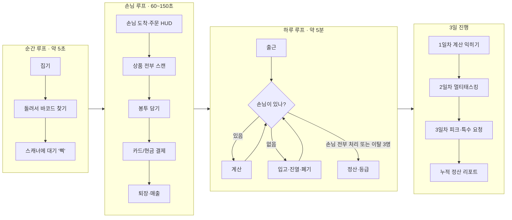

# VR 편의점 알바 시뮬레이터 — 게임 기획서

> **기준일**: 2026-11-06 · **최종 발표 2026-11-17(화)**
> **문서 역할**: 제안서·구현 문서·마일스톤에 흩어진 게임 디자인(무엇을, 왜, 어떻게 플레이하는가)을 플레이어 경험 관점에서 한곳에 정리한 문서다. 수치·기술 규격의 원본은 [구현 문서](VR편의점_알바_시뮬레이터_구현_문서.md)이며(1.3절 원본 우선순위 규칙), 이 문서와 어긋나면 구현 문서를 따르고 이 문서를 고친다. 각 항목 끝의 `(구현 N.M)`이 원본 위치다.
> **표기**: **[제안]** = 이 문서에서 처음 내놓는 미확정 값이다. 11/15 플레이테스트에서 확정하고, 확정되면 구현 문서에 옮긴 뒤 표기를 지운다.

---

## 1. 한눈에 보기

| 항목 | 내용 |
|---|---|
| 한 줄 소개 | 가우시안 스플래팅(3DGS)으로 스캔한 **실제 편의점 상품**을 두 손으로 집고, 돌려서 바코드를 찾아 찍고, 봉투에 담고, 입고 박스를 뜯어 진열하는 VR 직업 체험 |
| 장르 | VR 직업 시뮬레이션 · 1인칭 · 싱글 플레이 |
| 플랫폼 | PCVR — **Meta Quest 2 + 유선 Link**(팀 보유 기기), Windows(RTX 4070), DX12 (구현 2.6·2.7) |
| 플레이 시간 | 1회 약 15분 — 1일차 약 5분(튜토리얼 포함), 2일차 약 5분, 3일차 약 5분 (구현 6.3) |
| 플레이 자세 | 서서 플레이, **매장 안을 썸스틱으로 자유롭게 걸어 다닌다**(실제 걸음도 가능) (구현 5.1, D11) |
| 대상 | 편의점 알바 경험이 없거나 적은 대학생, VR 초심자, 발표 현장의 체험자·평가자 |
| 차별점 | 기존 VR 직업 체험(Job Simulator의 Store Clerk 등)의 단순화된 모델 대신 **실사 3DGS 상품을 실측 크기 그대로** 손에 쥔다 (제안서 슬라이드 4) |

## 2. 기획 의도와 경험 목표

### 2.1 왜 이 게임인가 (제안서 슬라이드 3·4)

- **익숙한 공간** — 매일 가는 편의점, 매일 보는 상품이라 체험자가 "진짜 같은지"를 바로 판단할 수 있다. 실재감을 평가하기 좋은 소재다.
- **손으로 하는 일** — 집기, 돌려서 바코드 찾기, 찍기, 봉투에 담기, 박스 뜯기. VR 컨트롤러의 6자유도 움직임이 그대로 업무 동작이 된다.
- **실제 업무 흐름** — 계산 · 응대 · 입고 · 진열 · 폐기를 실제 순서대로 따라 하며, 일을 시작하기 전에 손에 익힐 수 있다.
- **과목 요건** — 3D 공간, HMD 실기기, NeRF/3DGS 활용이 필수다(구현 D9). 이 게임은 3DGS를 "보여주기"가 아니라 "손에 쥐고 쓰는" 방식으로 활용한다.

### 2.2 플레이어가 느껴야 할 것

| 경험 목표 | 설명 | 확인 방법 |
|---|---|---|
| "진짜 상품이다" | 손에 든 상품의 라벨 글씨·광택·크기가 실물 같다 | IPQ + 3DGS 특화 3문항 (구현 9.4) |
| "손이 바쁜데 할 만하다" | 손님 계산과 입고·진열·폐기 사이에서 우선순위를 판단하는 긴장감. 실수해도 흐름이 끊기지 않는다 | 일차별 이탈 수·과제 완료율, 플레이테스트 관찰 |
| "멀미 없이 15분" | 착용 내내 편안하다 | SSQ 사전·사후 비교 (구현 9.4), HMD 72fps (구현 7.1) |

## 3. 디자인 원칙

| 원칙 | 의미 | 그래서 이렇게 한다 | 하지 않는 것 |
|---|---|---|---|
| **진짜 같은 상품** | 상품은 전부 실사 3DGS, 실측 크기 | 상품 표의 실측 cm로 크기를 고정하고, 손에 든 상품은 원본 품질로 보여 준다 | 상품을 폴리곤 모델이나 사진 판으로 대체 (D9) |
| **손이 곧 업무** | 버튼 대신 손동작으로 일한다 | 바코드 면 찾아 돌리기, 지폐·동전 집어 놓기, 커터로 테이프 긋기, 플랩 젖히기 | 메뉴에서 "스캔"·"진열" 버튼 누르기 |
| **실제 업무 순서** | 계산 → 응대 → 입고·진열 → 폐기 → 정산 | 하루 루프가 실제 근무 순서를 따른다 | 업무와 상관없는 미니게임 |
| **막히지 않게** | 실수해도 계속 플레이할 수 있다 | 떨어뜨린 물건 자동 리스폰, 단계별 힌트, 반복 실패 시 자동 완료, 놓일 자리를 미리 보여 주는 진열 미리보기 | 게임 오버 화면, 처음부터 다시 하기 |
| **자유롭게, 하지만 멀미 없이** | 진짜 매장처럼 걸어 다니되 편안해야 한다 | 썸스틱 자유 이동(고정 속도·가속 없음) + 이동 중 시야 가장자리 어둡게(비네트), 45° 스냅 회전, 72fps, 허리 높이 작업대, 머리에 붙는 HUD 없음 | 부드러운 회전, 가속·걸음 흔들림 효과, 바닥에서 집기 |

## 4. 플레이어와 공간

### 4.1 역할

플레이어는 편의점 **신입 알바**다. 3일 동안 근무하며 1일차에는 계산을 배우고, 2일차에는 입고·진열·폐기가 더해지고, 3일차에는 피크 타임과 특수 요청을 처리한다. 스토리와 대사는 최소한(출근 안내·튜토리얼 음성·정산 피드백)으로 두고, **업무 자체가 콘텐츠**다. 2026-11-09부터 안내 음성은 점장의 말로 묶이고, 3일이 끝나면 종합 등급에 따라 점장이 결말을 말한다(10.0절). 입장과 튜토리얼 동안에는 점장이 앞치마를 두른 캐릭터로 매장에 서서 플레이어를 보며 말한다.

### 4.2 매장 배치

제안서 슬라이드 12의 구성도를 따른다. 아래 그림은 위에서 본 대략적인 배치이며, 정확한 치수와 창고 입구 위치는 매장 레이아웃 확정(마일스톤 P3-K1) 때 정한다.

```text
┌──────────────────────── 음료 냉장고 ───────────────────────┐
│                     ④                       전자레인지·온수기 │
│  진열대 A (라면·과자)   ②                         ⑤          │
│  진열대 B (즉석식품)    ③          ┌─ 계산대 ─┐               │
│  진열대 C (생활용품)               │POS·스캐너│ ① 나(점원)     │
│                                    └──────────┘     폐기함    │
│  입구                                    ⑥ 창고 입구(위치 미정) │
└──────────────────────────────────────────────────────────────┘
```

### 4.3 주요 구역 6곳 (구현 5.1)

플레이어는 매장 안을 자유롭게 걸어 다닌다. 아래 6곳은 일이 일어나는 주요 구역이다. 계산대 안쪽(점원 구역)은 카운터 끝 통로로 드나들고, 진열대·계산대·벽은 통과할 수 없다.

| 번호 | 위치 | 여기서 하는 일 |
|---|---|---|
| ① | 계산대 안쪽(시작 위치) | 스캔·스캔 취소·봉투·카드·현금 결제, 주문 HUD 확인 |
| ② | 진열대 A 앞(라면·과자) | 입고 박스 거치·개봉·진열, 만료 상품 집기 |
| ③ | 진열대 B/C 앞(즉석식품·생활용품) | 입고 박스 거치·개봉·진열, 만료 상품 집기 |
| ④ | 음료 냉장고 앞 | 만료 상품 집기(냉장고 입고는 이번 범위 밖) |
| ⑤ | 전자레인지·온수기·폐기함 앞 | 데우기·온수 붓기(3일차), 만료 상품 폐기 |
| ⑥ | 창고 입구 | 입고 카트에서 박스 고르기, 빈 박스 수거함 |

## 5. 조작 (Quest 2 · Oculus Touch 컨트롤러)

양손 조작은 같다(왼손·오른손 어느 쪽으로도 모든 행동 가능). 입력 매핑은 XR Interaction Toolkit Starter Assets 기본값을 그대로 쓴다 (구현 2.7).

| 입력 | 동작 |
|---|---|
| **그립**(중지 버튼) 누르기 / 떼기 | 잡기 / 놓기 — 상품·카드·지폐·동전·박스 손잡이·커터·플랩 |
| **손목 회전** | 잡은 상품을 돌려 바코드 면 찾기 |
| **검지 끝으로 누르기**(Poke) | POS 화면의 `[−]` 취소 버튼 |
| **트리거**(검지 버튼) | 레이로 POS 버튼 클릭(Poke 대신 쓸 수 있음) |
| **왼손 썸스틱** | 매장 안 자유 이동 — 바라보는 방향 기준, 일정 속도(1.5m/s), 옆걸음 가능. 이동 중에는 시야 가장자리가 살짝 어두워진다 |
| **오른손 썸스틱 좌·우** | 45° 스냅 회전 |
| **실제로 걷기** | 가디언 범위 안에서는 몸으로 걸어도 된다 |

A/B/X/Y·메뉴 버튼의 용도(일시정지·시점 재조정 등)는 정하지 않았다(19장 미결 사항).

## 6. 게임 루프



- **순간 루프**는 게임의 손맛이다. 상품마다 바코드 위치(바닥·뒷면·옆면)가 달라 매번 손목을 돌려 찾아야 한다 — 제안서의 "바코드 찾기가 곧 게임 규칙" (구현 5.3).
- **손님 루프**는 손님 1명을 처리하는 단위다. 손님마다 제한시간이 있고(1일차는 초과해도 이탈 없음), 계산은 한 번에 1명씩 한다. 다음 손님들은 미리 들어와 매장을 둘러보다 계산대 앞에 줄을 선다 (구현 6.1·6.3, D12). **[제안]** 시간 막대가 절반 넘게 남았을 때 끝내면 그 손님은 만족도 100%에 팁을 준다. 끝내는 순간 감사 음성과 금액 카드가 바로 나온다(11장).
- **하루 루프**에서 2일차부터 손님이 없는 시간에 입고·진열·폐기를 한다. 손님이 오면 하던 일을 그대로 두고 계산대로 돌아간다 (구현 6.2·5.7.2). 자리를 비워도 왼손 손목시계로 남은 시간과 대기 인원을 보고 돌아갈 때를 판단한다(13장). **[제안]** 계산이 늦어 줄이 길어지면 뒤 손님의 제한시간이 줄어들어(8장), 피크 때 압박이 실제로 쌓인다.

## 7. 핵심 메커닉

### 7.1 잡기·돌리기·놓기 (구현 5.2)

| 플레이어 행동 | 판정 | 피드백 | 실수했을 때 |
|---|---|---|---|
| 그립으로 상품을 잡고, 손목을 돌리고, 놓는다 | 상품의 보이지 않는 상자 콜라이더(실측 크기) 기준으로 잡힌다 | 약한 진동(0.3 / 0.05초) | 바닥에 떨어지면 3초 뒤 원래 자리(계산대의 놓였던 곳 또는 꺼낸 박스)로 돌아간다 |

### 7.2 바코드 스캔 (구현 5.3)

| 플레이어 행동 | 판정 | 피드백 | 실수했을 때 |
|---|---|---|---|
| 바코드 면을 찾아 스캐너의 세워진 유리 앞에 든다. 닿지 않아도 된다(유리 앞 약 24cm까지). 바닥 유리에 바코드 면을 대도 찍힌다 | 바코드 면에 붙은 얇은 판정 구역이 유리 앞 공간에 들어오고, 바코드 면이 그 유리를 50° 안으로 향할 때만 찍힌다. 상품 몸통은 반응하지 않는다. 속도 제한은 없다 | '삑' + 초록 표시등 깜빡임 + 붉은 빛이 잠깐 꺼짐 + 강한 진동(0.6 / 0.1초), POS 목록과 주문 HUD에 체크 | 스캐너 앞에 있는 동안은 한 번만 찍힌다. 두 유리 밖으로 0.8초 넘게 뺐다가 다시 대야 또 찍힌다(이중 스캔 방지) |

- 붉은 빛은 세워진 유리에서 나온다(2026-11-10). 아무것도 없으면 바닥 유리에 붉은 줄 하나가 떨어지고, 상품을 유리 앞에 들면 그 줄이 상품 면으로 올라온다. 바닥 유리에는 그려진 빛이 없다.
- 난이도는 상품마다 다른 바코드 면(`bottom` 바닥 / `back` 뒷면 / `side` 옆면)에서 나온다. 컵라면은 바닥, 삼각김밥은 뒷면, 생수병은 옆면 (구현 4.1·4.4).

### 7.3 스캔 취소 (구현 5.3)

주문에 없는 상품을 찍었거나 너무 많이 찍었으면, POS 화면에서 그 품목 줄 오른쪽 `[−]` 버튼을 검지로 누르거나 레이로 클릭한다. 수량이 1 줄고 '띡' 소리가 난다. 취소 횟수는 정산의 정확도에 들어간다.

### 7.4 봉투 담기 (구현 5.4)

주문 HUD에 "봉투 필요"가 있으면 스캔한 상품을 비닐봉투에 넣는다(봉투 안에서 천천히 0.3초 멈추면 담김). 봉투는 손잡이 달린 흰 비닐봉투가 벌어진 채 계산대에 서 있는 모양이고, 담긴 상품은 그 안에 세워진다(2026-11-11). 결제가 끝나면 손님은 그 봉투를 왼손에 들고 나간다. "봉투 필요"가 없으면 계산대 위에 둔다.

### 7.5 결제 (구현 5.5)

| 결제 | 플레이어 행동 | 완료 조건 | 실수했을 때 |
|---|---|---|---|
| 카드 | 손님이 내민 카드를 집어 단말기 앞면(점원 쪽)의 노란 테두리 슬롯에 꽂는다. 카드를 들면 꽂을 자리에 흐린 카드가 보이고, 슬롯 가까이 가져가면 카드가 바른 자세로 빨려 들어간다. 손을 놓아도 꽂힌 채 남는다 | 0.5초 꽂아 두면 '띠르릉' 승인. 꽂히면 테두리가 초록이 된다 | 카드를 떨어뜨리면 접시 위로 즉시 돌아온다 |
| 현금 | 스캔과 봉투가 끝나면 POS 아래 금전출납기 서랍이 열린다. 받은 지폐를 서랍에 넣고, POS에 뜬 거스름돈만큼 서랍 칸의 지폐(50,000·10,000·5,000·1,000원)·동전(500·100·50·10원)을 집어 접시에 놓는다. POS에는 받은 돈·거스름돈·접시에 놓은 돈이 나란히 보인다 | 접시 위 합계가 맞으면 0.5초 뒤 완료, 서랍이 닫힌다 | 틀리면 '땡' + 지금 놓인 금액 표시. 잘못 집은 화폐는 서랍에 다시 넣으면 제 칸으로 돌아간다 |

거스름돈 액수는 POS가 자동으로 계산해 보여 준다. 암산이 아니라 "맞는 화폐를 집어 놓는 손동작"이 과제다.

### 7.6 입고 박스 개봉·진열 — 2·3일차 (구현 5.7, D10)

사용자 요구로 추가된 기능이다. 실제 편의점 입고 업무처럼, 들어온 박스를 뜯어 상품을 **한 개씩** 진열한다.

| 단계 | 플레이어 행동 | 판정·피드백 |
|---|---|---|
| ① 고르기·운반 | 창고 입구 입고 카트에서 박스 옆면 라벨(상품명 ×수량, 대상 칸 예: `A-2`)을 보고 고른다. 손잡이 구멍을 잡고 든 채 대상 진열대 앞까지 걸어간다 | 대상 칸에 노란 하이라이트 |
| ② 거치 | 진열대 앞 허리 높이(0.8m) 거치대에 올린다 | 정위치로 '툭' 스냅 |
| ③ 테이프 자르기 | 거치대 옆 커터를 집어 윗면 테이프 선을 따라 긋는다 | 체크포인트 6개를 순서대로 지나면 잘림. 지날 때마다 '찌익' + 진동 |
| ④ 플랩 열기 | 날개 2장을 잡고 바깥으로 젖힌다 | 110° 넘게 젖혀서 놓으면 활짝 열림, '펄럭'. 안의 상품이 보인다 |
| ⑤ 꺼내기 | 박스 안 상품을 하나 집는다 | 손에 원본 품질 상품이 잡힌다 |
| ⑥ 진열 | 상품을 든 채 노란 칸을 바라본다. 놓일 자리에 **흐린 상품 모습 + 초록 테두리**(미리보기)가 뜨면 손을 놓는다 | 상품이 미리보기 자리로 쏙 들어가며 '착', 칸 수량 표시(예: `4/6`). 미리보기가 뜰 때·자리가 바뀔 때 약한 진동 |
| ⑦ 빈 박스 수거 | 다 비운 박스를 창고 입구 수거함에 넣는다 | '털썩' |

- **박스 규칙**: 박스 1개에 상품 1종, 한 층으로 4·6·8개. 한 번에 열어 둘 수 있는 박스는 1개 (구현 5.7.2).
- **진열 미리보기**: 바라보는 곳에서 가장 가까운 빈자리에 미리보기가 뜬다. 손이 칸에서 약 60cm 안에 있어야 뜨고, 칸마다 앞자리부터 채운다. 상품 방향은 자동으로 앞면이 통로 쪽을 보게 맞춰진다 (구현 5.7.5).
- **실수**: 다른 상품 칸이나 꽉 찬 칸을 보면 미리보기 대신 **빨간 테두리**가 뜨고, 그 상태에서 놓으면 '땡' + 오진열 1회, 상품은 박스로 돌아간다. 아무 테두리도 없을 때 놓으면 그냥 떨어지고 3초 뒤 박스로 돌아간다(감점 없음). 커터를 놓으면 1초 뒤 홀더로 돌아간다. 테이프를 긋다 2초 넘게 멈추면 처음부터 다시 긋는다.
- **재고는 연결되지 않는다**: 진열한 상품이 손님 주문에 영향을 주지 않는다. 진열은 독립 과제로 정산한다.
- **3일차 중간 입고**: 3일차에는 6번째 손님이 끝난 직후 박스 1개가 더 도착한다(알림음 + HUD "입고 도착").

### 7.7 유통기한 폐기 — 2·3일차 (구현 6.4)

일차 시작 때 진열 상품 3개(그날 입고 대상 칸은 제외)에 보라·빨강 만료 아이콘이 붙는다. 해당 진열대로 걸어가 만료 상품을 집어 폐기함에 넣으면 폐기 1회. 멀쩡한 상품을 넣으면 '땡' + 폐기 오탐 감점.

### 7.8 특수 요청 — 3일차 (구현 6.4)

| 요청 | 주문 HUD 표기 | 플레이어 행동 | 완료 |
|---|---|---|---|
| 1+1 행사 | (같은 상품 2개를 내려놓음) | 2개 모두 스캔 | POS가 1개 값만 청구 |
| 전자레인지 | "전자레인지 데우기" | 스캔한 도시락·삼각김밥을 전자레인지에 넣는다 | 3초 작동음·조명 뒤 '땡' |
| 컵라면 온수 | "온수 붓기" | 스캔한 컵라면을 온수기 아래에 2초 둔다 | 물 붓는 소리 뒤 완료 |

특수 요청은 1일차 MVP가 완성된 뒤에만 만든다. 11/12(목) 22:00까지 1일차 플레이가 완성되지 않으면 특수 요청은 빠지고 3일차는 피크 타임 + 입고·폐기로만 진행된다(디스코프 T1, 구현 8.5).

## 8. 손님 (구현 6.1·6.2)

| 요소 | 내용 |
|---|---|
| 모습 | 무료 3D 인간형 캐릭터 — Microsoft Rocketbox 반실사 성인 4종(일상복, MIT, 2026-11-07 선택). 커스텀 모델링 없음 |
| 움직임 | 입구 → 진열대 1~2곳 구경 → 계산대 줄 → 계산대 앞 → 퇴장을 걸어서 이동. 애니메이션은 대기·걷기·퇴장 3종(구경은 진열대를 보는 대기 자세) |
| 얼굴과 반응 (2026-11-09) | 계산대에서는 플레이어를 바라보고(머리·눈), 줄에서는 때때로 쳐다보고, 가까이 지나가면 돌아본다. 눈을 깜빡이고, 말할 때 음량에 맞춰 입이 움직인다. 빨리 끝내면 미소와 끄덕임, 재촉·이탈 때는 찌푸림과 고개 젓기. 줄에서 45초를 넘게 기다리면 표정이 굳고, 계산대에서 "한참 기다렸어요"라고 말한다 |
| 주문 | 계산대 앞에 서서 살 상품을 계산대 위에 바로 내려놓는다(바구니 없음, 2026-11-10). 주문은 ① 품목·수량 ② 봉투 필요 여부 ③ 결제 수단(카드/현금) + 3일차 특수 요청 |
| 인내심 | 손님마다 제한시간. 절반이 지나면 재촉 음성, 0이 되면 이탈 음성과 함께 걸어 나간다(1일차는 이탈 없음). **[제안]** 2·3일차에는 줄에서 45초를 넘게 기다린 시간의 절반만큼 계산대 제한시간이 줄어든다(최대 제한시간의 40%). 주문 카드에 "오래 기다렸어요"로 표시된다 |
| 음성 | 인사 4종, 재촉 1종, 이탈 1종, 특수 요청 4종, 감사 2종(보통·빨랐을 때), 오래 기다림 1종. 캐릭터 위치에서 들린다 |
| 계산 순서와 줄 | 계산은 한 번에 1명. 다음 순번 손님 최대 2명이 미리 들어와 구경하다 계산대 앞에 줄을 선다(줄 최대 3명). 직전 손님이 끝난 뒤 정해진 시간이 지나면 줄 맨 앞 손님이 계산대로 온다. 제한시간은 계산대 앞에 선 뒤부터 잰다 |
| 구경 손님 | 사지 않고 진열대 사이를 걷다 나가는 손님, 동시에 1~2명 **[제안]**. 줄에 서지 않고 점수와 무관하다 |

손님 수·간격·제한시간(9장)은 줄과 구경 손님이 생겨도 그대로다. 줄과 구경 손님은 11/07 Quest 2 리허설에서 "손님이 한 명씩 인위적으로 온다"는 착용 소감을 받아 넣었다(구현 D12).

손님이 상품을 손가락으로 집는 정교한 동작은 만들지 않는다. 상품은 손님이 계산대 앞에 서는 순간 계산대 위에 내려놓이고, 결제는 접시에 놓이는 카드·지폐로 표현한다.

## 9. 3일 구성과 난이도 곡선 (구현 6.3)

| 일차 | 새로 배우는 것 | 손님 | 다음 손님까지 | 손님당 제한 | 추가 과제 | 끝나는 조건 | 예상 시간 |
|---|---|---|---|---|---|---|---|
| **1일차** | 잡기·바코드 찾기·스캔·봉투·카드·현금 | 5명 | 10초 | 150초 (초과해도 이탈 없음, 경고음만) | 없음 — 튜토리얼 6단계 + 계산 | 5명 완료 | 약 5분 |
| **2일차** | 입고 박스 개봉·진열, 유통기한 폐기, 손님과 과제 사이 우선순위 | 8명 | 15초 | 120초 (초과 시 이탈) | 입고 박스 2개(6입·4입 = 10개 진열) + 입고 안내 4단계, 폐기 3개 | 8명 처리 또는 이탈 3명 | 약 5분 |
| **3일차** | 피크 타임 압박, 특수 요청, 중간 입고 | 12명 | 일반 20초 / 피크(9~12번째) 10초 | 일반 90초 / 피크 60초 | 입고 박스 2개(1개는 6번째 손님 뒤 도착) + 폐기 + 특수 요청 | 12명 처리 또는 이탈 3명 | 약 5분 |

- **난이도 곡선**: 1일차는 "손에 익히기"(처벌 없음), 2일차는 "한꺼번에 여러 일"(손님이 없는 15초 동안 입고·폐기를 끼워 넣는다), 3일차는 "압박"(피크 4명이 10초 간격으로 들어오고 특수 요청이 계산을 길게 만든다).
- **진열은 끝내지 않아도 된다**: 일차는 손님 기준으로 끝난다. 남은 진열은 완료율로만 정산된다.
- **다음 날로 넘어가기**: 정산판 아래 "2일차 시작" 버튼을 POS `[−]`처럼 레이와 트리거로 누르면 다음 날 출근이 시작된다. 쉬는 시간은 플레이어가 정한다 (2026-11-08 사용자 결정, 구현 6.2).
- **조정은 데이터로**: 손님 수·간격·제한시간은 `Data/scenarios.csv`, 박스 수·입수는 `Data/deliveries.csv`로 바꾼다. 코드를 고치지 않고 11/15 플레이테스트 결과로 조정한다 (구현 6.5).

## 10. 온보딩

### 10.0 타이틀과 출근·퇴근 (2026-11-09 추가)

게임을 켜도 아무것도 시작되지 않고 닫힌 매장 문 앞에서 기다린다. 헤드셋을 쓰기 전에 튜토리얼 음성이 지나가는 일이 없고, 체험자가 바뀌어도 게임을 다시 실행하지 않아도 된다.

| 단계 | 플레이어가 하는 일 | 게임이 하는 일 | 막혔을 때 |
|---|---|---|---|
| 타이틀 | 유리문의 작은 안내판에서 레이와 트리거로 **출근하기**를 누른다. **설정**을 누르면 2일차부터, 3일차부터, 이동 속도(보통·느리게), 화면 가장자리(보통·진하게), 시점 다시 맞추기가 나온다 | 플레이어를 문 앞에 세운다. 유리 너머로 진열이 끝난 매장과 계산대 끝의 점장, 장을 보는 손님 2명이 보인다. 고른 일차에 맞게 매장을 준비한다 | 머리가 1m 넘게 벗어난 채 1.5초가 지나면 시점을 다시 맞춘다 |
| 걸어서 입장 | 문이 열리면 왼손 스틱으로 노란 화살표를 따라 계산대 안쪽 초록 네모까지 걷는다 | 도어벨. 점장이 손을 흔들며 플레이어를 보고 인사한다. 안내판과 왼손 옆에 스틱 쓰는 법이 처음부터 나온다 | 20초 뒤 방향 돌리기 안내, 75초 뒤 계산대로 옮겨 준다 |
| 출근 카드 | 접시의 **출근 카드**를 집어 단말기 노란 칸에 꽂는다 | 결제 카드와 같은 슬롯과 안내. 화살표가 카드, 집은 뒤에는 슬롯을 가리키고 양손 옆에 "가운뎃손가락 버튼을 꾹"이 나온다. 꽂으면 점장이 끄덕인다 | 20초 뒤 더 쉬운 안내, 70초 뒤 통과 |
| 퇴근 | 마지막 날 리포트를 읽고 **퇴근 카드**를 꽂는다 | 종합 등급별 결말과 점장 음성 | 출근 카드와 같음 |
| 결말 | "처음으로"를 누른다 | 기록을 비우고 타이틀로 돌아간다 | - |

| 종합 등급 | 결말 |
|---|---|
| S | 정규직 제안 |
| A | 다음 주 근무표 확정 |
| B | 수습 기간 연장 |
| C | 재교육 대상 |

일차 사이의 "N일차 시작" 버튼은 그대로다. 근무 도중에 타이틀로 돌아가는 기능은 없다(19장).

### 10.1 1일차 튜토리얼 6단계 (구현 5.6)

계산대 위 가이드 보드 + 점장 음성 + 대상 위 화살표로 진행한다. 2026-11-09부터 실제 손님을 응대하면서 배운다. 장을 보던 손님이 계산대로 와 상품을 내려놓고 인사하면 T1이 시작되고, 카드 결제까지 끝나면 그 손님이 고맙다고 하고 떠난다("+금액" 카드). 다음 손님이 와서 T6 현금을 맡는다. 두 손님은 튜토리얼 전용이고 1일차 주문 5건과 매출에 넣지 않는다. 끝나면 "튜토리얼 완료"가 4초 보이고 점장이 은행에 간다며 정문으로 나간다.

화살표는 각 단계가 시작될 때부터 보인다. 첫 그립 전까지 양손 옆에 "가운뎃손가락 버튼을 꾹"이 함께 나온다.

| 단계 | 지시 | 완료 조건 | 화살표 | 막혔을 때 |
|---|---|---|---|---|
| T1 잡기 | 손님 상품 집기 | 그립으로 잡음 | 상품 위 "집기" | 15초 뒤 더 쉬운 안내 |
| T2 돌리기 | 손목을 돌려 바코드 면 찾기 | 바코드 면이 스캐너 쪽 ±60° 안에서 1초 유지 | 손에 든 상품의 바코드 면 "바코드" | 15초 뒤 더 쉬운 안내 |
| T3 스캔 | 붉은 빛이 나오는 세워진 유리 앞에 들기 | '삑' 1회 | 세워진 유리를 비스듬히 가리키는 "여기에 대기" | 20초 뒤 더 쉬운 안내("닿지 않아도 됩니다") |
| T4 봉투 | 손님의 봉투 요청 뒤 비닐봉투에 넣기 | 봉투에 담김 | 봉투 위 "여기에 넣기" | 떨어뜨리면 3초 뒤 계산대의 놓였던 자리로 |
| T5 카드 | 카드를 집어 단말기에 꽂기 | '띠르릉' | 카드 "집기" → 슬롯 "여기에 꽂기" | 떨어뜨리면 접시로 즉시 |
| T6 현금 | 다음 손님의 5,000원을 받고 3,500원 거슬러 주기 | 접시 금액 일치 | 지폐 "집기" → 서랍 "서랍에 넣기" → 다음에 집을 화폐 칸 위에 금액("1,000원") → 접시 "접시에 놓기", 넘치면 접시 "덜어내기" | 2회 틀리면 보드에 필요한 화폐 조합, 3회 틀리면 자동 완료 |

### 10.2 2일차 입고 안내 4단계 (구현 5.7.4)

첫 박스에서만 안내한다. 첫 손님은 I4를 마치거나 안내 시작 후 90초가 지나야 들어온다.

| 단계 | 지시 | 완료 조건 | 막혔을 때 |
|---|---|---|---|
| I1 운반 | 창고 입구 카트에서 컵라면 박스를 들고 진열대 A로 가기 | 거치대에 올림 | 20초 무행동 시 박스·목적지 하이라이트 |
| I2 자르기 | 커터로 테이프 선 따라 긋기 | 테이프 절단 | 2번 실패하면 체크포인트 구슬 표시, 4번 실패하면 자동 절단 |
| I3 열기 | 날개를 바깥으로 젖히기 | 박스 열림 | 15초 뒤 날개 테두리 깜빡임 |
| I4 진열 | 상품 하나를 꺼내 들고 노란 칸 바라보기 → 초록 미리보기가 뜨면 손 놓기 | 1개 진열 | 15초 동안 미리보기가 안 뜨면 칸 쪽 화살표. 떨어뜨리거나 잘못 놓으면 박스로 돌아감(벌점 없음) |

### 10.3 3일차 특수 요청

주문 HUD에 요청 문구가 표시된다. **[제안]** 각 요청이 처음 나올 때 한 번만 가이드 보드에 그림 안내 + 짧은 음성("이 손님은 전자레인지에 데워 드려야 해요")을 띄운다.

## 11. 점수와 정산 (구현 6.5)

일차가 끝나면 정산 화면이 뜨고, 3일차가 끝나면 1~3일차 누적 리포트가 뜬다. 등급은 **S / A / B / C** 네 단계다.

| 정산 항목 | 측정 | 반영 |
|---|---|---|
| 매출 합계 | 결제 완료한 주문 금액의 합 | 기본 점수 |
| 이탈 손님 수 | 제한시간 초과로 나간 손님 | 매출 손실 + 응대 점수 감소 |
| 손님 만족도 | 계산을 끝낸 순간 제한시간이 얼마나 남았는가 | 2·3일차 응대 점수 |
| 팁 | 시간 막대가 절반 넘게 남았을 때 끝낸 손님이 주는 돈 | 점수와 별개로 정산판과 손목시계에 표시 |
| 오스캔(취소) 횟수 | `[−]` 취소 횟수 | 정확도 감점 |
| 폐기 오탐 | 멀쩡한 상품을 폐기함에 넣은 횟수 | 정확도 감점 |
| 오진열 | 다른 칸·꽉 찬 칸에 놓은 횟수 | 정확도 감점 |
| 미수거 빈 박스 | 일차 종료 때 남은 빈 박스 | 정확도 감점 |
| 과제 완료율 | (진열 개수 + 폐기 개수) ÷ (입고 총 개수 + 만료 상품 수) | 과제 점수 |

**[제안] 초기 점수식** (100점 만점, 11/15 플레이테스트로 조정):

- 2·3일차: `점수 = 40 × 매출 달성률 + 25 × 평균 손님 만족도 + 15 × 정확도 + 20 × 과제 완료율` (정면 진열 가산은 미리보기 스냅이 방향을 자동으로 맞추므로 없앴다)
- 1일차(과제 없음): `점수 = 50 × 매출 달성률 + 30 × (1 − 이탈 수 ÷ 손님 수) + 20 × 정확도`. "처벌 없이 손에 익히기"인 날이라 속도는 점수에 넣지 않고 팁으로만 보상한다
- `손님 만족도`(손님별, 2026-11-09): 시간이 절반 이상 남았으면 1, 그 아래로는 남은 시간에 비례해 0.4까지 내려가고, 이탈은 0. 계산대까지 오지 못한 손님도 0으로 평균에 들어간다
- `팁` = 주문 금액의 10%를 100원 단위로 반올림(최소 100원). 재촉 음성이 나오기 전에 끝내면 받는다는 규칙이다
- `매출 달성률` = 실제 매출 ÷ 그 일차 전체 주문 금액, `정확도` = max(0, 1 − 0.1 × (오스캔 + 폐기 오탐 + 오진열 + 미수거 박스))
- 등급: **S ≥ 90 · A ≥ 75 · B ≥ 60 · C < 60**. 이탈 3명으로 일찍 끝난 일차는 별도 게임 오버 없이 낮은 등급으로 피드백한다.

## 12. 실패와 회복 — 막히지 않게

| 상황 | 처리 | 원본 |
|---|---|---|
| 상품·카드·지폐를 바닥에 떨어뜨림 | 3초 뒤 원래 자리로 리스폰(카드는 즉시) | 구현 5.2·5.5 |
| 주문에 없는 상품을 스캔 | POS `[−]`로 취소 | 구현 5.3 |
| 거스름돈을 계속 틀림 | 튜토리얼에서는 2회 힌트·3회 자동 완료, 본 근무에서는 현재 금액 표시 | 구현 5.5·5.6 |
| 손님 제한시간 초과 | 1일차: 경고음만 / 2·3일차: 이탈(매출 손실) | 구현 6.3 |
| 이탈 3명 | 그 일차 즉시 정산으로(게임 오버 없음) | 구현 6.3 |
| 잘못된 칸에 진열 | 놓기 전에 빨간 테두리로 미리 경고, 그래도 놓으면 '땡' + 상품은 박스로 복귀 | 구현 5.7.5 |
| 진열할 자리를 못 찾음 | 대상 칸 노란 하이라이트 + 바라보면 초록 미리보기. 튜토리얼에서는 15초 뒤 칸 쪽 화살표 | 구현 5.7.4·5.7.5 |
| 테이프를 끝까지 못 그음 | 2초 넘게 멈추면 처음부터. 20초 뒤 가이드 화살표 | 구현 5.7 |
| 박스를 떨어뜨림 | 3초 뒤 마지막 거치 위치로 | 구현 5.7 |
| 진열 중 손님 도착 | 도어벨 + HUD 깜빡임 + 손목시계 깜빡임과 왼손 진동. 박스·칸 진행 상태는 그대로 유지 | 구현 5.7.2 |
| 헤드셋을 늦게 썼거나 다른 곳에서 썼음 | 타이틀에서 시점을 자동으로 다시 맞춤, "시점 다시 맞추기" 버튼 | 10.0절 |
| 입장 때 걷지 못함 | 20초 뒤 조작 안내, 75초 뒤 계산대로 이동 | 10.0절 |
| 출근·퇴근 카드를 꽂지 못함 | 20초 뒤 더 쉬운 안내, 70초 뒤 통과 | 10.0절 |

## 13. UI·HUD

모든 UI는 **월드 공간에 고정**하거나 손에 붙인다(머리를 따라다니는 HUD는 멀미와 시야 가림 때문에 쓰지 않는다).

| UI | 위치 | 내용 |
|---|---|---|
| 타이틀 | 닫힌 출입문 | 게임 이름, 출근하기·2일차부터·3일차부터, 이동 속도·화면 가장자리·시점 다시 맞추기 |
| 입장 안내 | 출입문 안쪽 공중, 바닥 화살표와 초록 네모 | 어디로 걸어갈지 |
| 주문 HUD | POS 위, 점원 시선 정면 | 손님 번호, 주문 목록(스캔하면 체크), 남은 시간과 팁 기준(막대 절반 표시), 봉투·결제 수단·특수 요청 |
| 손목시계 | 왼손 손등, 손을 들어 본다. 근무 중에만 | 일차, 대기 인원, 계산대 손님과 남은 시간, 이탈 수, 오늘 번 돈. 손님 도착·재촉 때 깜빡이고 진동 |
| 결과 카드 | 계산대 위 중앙, 1.8초 | "+3,300원 · 팁 300원", 이탈 때 "손님이 떠났습니다 · 이탈 1/3" |
| POS 화면 | 계산대 | 스캔 품목 목록, 품목별 `[−]` 취소 버튼, 합계, 현금 결제 중에는 받은 돈·거스름돈·접시에 놓은 돈 |
| 가이드 보드 | 계산대 위 | 튜토리얼·입고 안내 지시문, 그림 안내 |
| 박스 라벨 | 박스 옆면 | 상품명 ×수량, 대상 칸 코드 |
| 칸 수량 표시 | 대상 칸 앞 | 진열 수 / 칸 용량(예: `4/6`) |
| 진열 미리보기 | 바라본 빈자리 | 흐린 상품 모습 + 초록 테두리(놓을 수 있음) / 빨간 테두리(놓으면 오진열) |
| 정산 화면 | 계산대 위 대형 보드 | 정산 항목, 점수, 등급, 3일차 누적 리포트 |

- **표시 규칙**: 노란 하이라이트 = 지금 가야 할 칸, 초록 테두리 + 흐린 상품 = 여기에 놓인다, 빨간 테두리 = 여기 놓으면 안 된다, 보라·빨강 아이콘 = 만료 상품, 테두리 깜빡임 = 힌트. 색만으로 구분하지 않도록 아이콘·글자를 함께 쓴다.
- **Quest 2 가독성**: 글자 높이는 시선 각도 1.2° 이상(1m 거리에서 약 2.1cm), 중요한 UI는 시선 중앙 ±20° 안에 둔다. 최종 크기는 Quest 2 실기기에서 확정한다 (구현 2.7).

## 14. 사운드 (구현 5.1·6.1)

| 분류 | 소리 |
|---|---|
| 계산 | '삑'(스캔) · '띡'(스캔 취소) · '띠르릉'(카드 승인) · '철컹'(금전출납기 서랍 열림)·'철컥'(닫힘)·'짤랑'(동전)·'사락'(지폐) · '땡'(오류·조리 완료) |
| 입고 | '툭'(박스 거치) · '찌익'(테이프) · '펄럭'(플랩) · '착'(진열) · '털썩'(빈 박스 수거) · 배송 도착 알림음 |
| 계산 보상 | 팁 효과음 |
| 손님 음성 | 인사 4 · 재촉 1 · 이탈 1 · 특수 요청 4 · 감사 2 |
| 안내 음성 | 1일차 튜토리얼 6 · 2일차 입고 안내 4 · 특수 요청 첫 안내 3 · 점장 인사·출근·퇴근 3 · 결말 4 |
| 환경음 | 잔잔한 매장 소음, 입구 도어벨 |

모든 효과음은 3D 공간음으로, 소리가 나는 물건 위치에서 들린다.

## 15. 콘텐츠 목록

| 분류 | 내용 | 원본 |
|---|---|---|
| 상품 | 전부 실사 3DGS. 게이트 시험 3종(매트: 과자 봉지 · 인쇄: 삼각김밥 · 반사: 페트병 또는 캔) + 지속 반입. 예시 id: `ramen_cup_01` 컵라면, `kimbap_tri_01` 삼각김밥, `water_500_01` 생수. **11/10까지 누적 8종 이상(목표 11종)**, 11/14 반입 마감 | 구현 4.1·8.1·9.1 |
| 진열대 | A 라면·과자 / B 즉석식품 / C 생활용품, 음료 냉장고. 칸 코드 `A-1`, `A-2`… | 구현 5.1·6.5 |
| 매장 집기 | 계산대·POS·스캐너·카드 단말기·현금 서랍·접시, 전자레인지·온수기·폐기함, 입고 카트·박스 거치대·커터·빈 박스 수거함, 비닐봉투, 바구니 | 구현 2.3·5.1 |
| 매장 꾸미기 (2026-11-09) | 가격표, 행사 포스터와 걸개 간판, 냉장고 문 필름, 빈 칸의 닫힌 운송 상자, 입구 매트, 줄 서기 스티커, 시계·비상구·CCTV. 글자와 색뿐이고 상품 사진·모델은 쓰지 않는다(D9). 전부 불투명하고 충돌체가 없다 | `docs/p2/매장꾸미기_2026-11-09.md` |
| 손님 | 무료 3D 캐릭터 에셋, 애니메이션 3종 | 구현 6.1 |
| 데이터 | `Data/products.csv`(상품 표) · `Data/scenarios.csv`(주문 시나리오) · `Data/deliveries.csv`(입고 박스) | 구현 4.1·6.5 |

## 16. 편안함과 접근성

- **멀미**: 자유 이동은 고정 속도(가속·흔들림 없음)이고, 움직이거나 돌 때만 시야 가장자리를 어둡게 하는 비네트를 켠다. 회전은 45° 스냅만 쓴다. HMD 72fps 유지가 목표 (구현 5.1·7.1). 멀미 호소가 있으면 비네트를 진하게 하고 속도를 1.0m/s로 낮춘다.
- **공간**: 가디언은 룸스케일 2m×2m 이상을 권장한다. 몸이나 손에 든 물건이 진열대·손님에게 걸려 멈추지 않도록 충돌을 정리했다 (구현 2.7·5.1).
- **자세**: 박스 거치대·입고 카트 상판·폐기함 투입구를 허리 높이(약 0.8m)로 두어 허리를 굽히지 않게 한다. 바닥에 떨어진 물건은 자동으로 돌아오므로 주울 필요가 없다 (구현 2.7).
- **착용 시간**: 1회 15분 안팎. 설문 체험 전에 IPD(렌즈 간격 58·63·68mm) 3단계를 맞추고, 안경 착용자는 안경 스페이서를 끼운다 (구현 9.4).
- **양손**: 모든 조작을 왼손·오른손 어느 쪽으로도 할 수 있다.

## 17. 범위와 우선순위 (11/17 발표 기준)

| 우선순위 | 기능 | 마감 | 지키는 장치 |
|---|---|---|---|
| **반드시** | 잡기·돌리기·스캔·취소·봉투·카드·현금, 손님 캐릭터(줄 서기·구경 손님 포함, D12), 1일차 + 튜토리얼, 정산 | 11/12(목) M2 | 줄·구경 손님이 M2까지 안 되면 1명씩 순차 등장으로 되돌림 **[제안]** |
| **해야 함** | 2일차 입고 박스 개봉·진열(D10)·폐기, 3일차 피크 타임, 진열대 병합·컷아웃·원거리 경량화, HMD 72fps | 11/15(일) M3 기능 동결 | 디스코프 T3(입고 축소) |
| **가능하면** | 특수 요청 3종, 박스 들고 운반, 3일차 중간 입고 | 11/15(일) | T1(특수 요청 제외), T3(운반·중간 입고 생략) |
| **이번엔 안 함** | 선입선출, 냉장고 입고, 빈 박스 접기, 박스 2단·두 손 운반, 손님 손 동작(IK), 재고 시뮬레이션 | — | 구현 5.7.2·6.1 |

- **T1**: 11/12(목) 22:00까지 1일차 플레이(M2)가 완성되지 않으면 특수 요청 3종을 뺀다.
- **T3**: 11/14(토) 18:00까지 2일차 입고 흐름이 완성되지 않으면 박스 운반을 생략(입고 카트를 진열대 앞에 두고 박스를 거치된 상태로 시작)하고, 3일차 중간 입고를 없애고, 일차당 박스를 1개로 줄인다. 테이프 자르기·플랩 열기·한 개씩 진열은 유지한다.
- 3D 공간·HMD 실기기·3DGS/NeRF 활용(D9)은 어떤 경우에도 줄이지 않는다.

## 18. 기획 검증 — 가설과 확인 방법

| 가설 | 확인 방법 | 시점 |
|---|---|---|
| 바코드를 찾아 돌리는 동작이 재미있는 핵심 손맛이 된다 | 플레이테스트에서 상품당 스캔까지 걸린 시간, T2 힌트 발동 빈도 관찰 | 11/15 플레이테스트 |
| 실사 3DGS 상품이 실재감을 높인다 | IPQ + 3DGS 특화 3문항(체험자 ≥5인, Quest 2 착용) | 11/16 설문 |
| 자유 이동이어도 비네트·고정 속도·스냅 회전·72fps로 멀미를 억제할 수 있다 | SSQ 사전·사후 비교, G1-H 5분 착용 확인 | 11/07~08 G1-H, 11/16 설문 |
| 자유 이동이 텔레포트보다 '진짜 매장에서 일하는' 느낌을 준다 | IPQ 공간적 존재감 요인, 자유 기술 응답 | 11/16 설문 |
| 2일차의 멀티태스킹이 "할 만한 긴장"이다 | 2일차 이탈 수(목표 1명 이하), 과제 완료율(목표 70% 이상) **[제안]** | 11/15 플레이테스트 |
| 팁과 줄 대기 벌칙이 "빨리 끝내고 싶은 이유"가 된다 | 손님별 남은 시간 비율, 일차별 팁, 줄 벌칙을 받은 손님 수, "손님을 세워 두고 진열을 계속"하는지 관찰 **[제안]** | 11/15 플레이테스트 |
| 손목시계를 실제로 들여다본다 | 근무 중 손을 들어 보는지 관찰, 자유 기술 응답 | 11/15 플레이테스트 |
| 걸어서 입장하면 처음 이동이 쉬워진다 | 입장에 걸린 시간, 20초 안내·75초 구조 발동 비율 | 11/15 플레이테스트 |
| 입고 박스 개봉이 직관적이다 | 입고 안내 I2·I3 자동 완료·힌트 발동 비율 | 11/15 플레이테스트 |
| 진열 미리보기 덕분에 진열이 빠르고 덜 답답하다 | 진열 1개당 걸린 시간(목표 8초 이하 **[제안]**), 오진열 횟수, 미리보기 자리 깜빡임 관찰 | 11/15 플레이테스트 |

## 19. 미결 사항

| 항목 | 정할 사람 | 기한 |
|---|---|---|
| 점수식 가중치·등급 경계(11장 [제안]) | 이민건(정산 로직) + 권도훈(플레이테스트) | 11/15 |
| A/B/X/Y·메뉴 버튼 용도(일시정지·시점 재조정) | 이민건 | 11/12 |
| 최종 상품 목록과 진열대 칸 배정 | 권도훈 | 11/12 |
| 창고 입구 위치와 매장 치수 | 권도훈(P3-K1) | 11/11 |
| 3일차 특수 요청 첫 등장 안내(10.3 [제안]) | 이민건 | 11/14 |
| 2일차 목표치(이탈 1명 이하·완료율 70%, 18장 [제안]) | 권도훈 | 11/15 |
| 줄·구경 손님 수치(구경 시간, 구경 손님 수, 8장 [제안]) | 이민건(구현) + 권도훈(플레이테스트) | 11/15 |
| 진열 미리보기의 흐린 상품 표현 — 0.3은 데스크톱에서 거의 불투명해 2026-11-08 비교로 0.08로 낮춤(구현 5.7.5). Quest 2에서 흐린 정도만 최종 확인 | 이민건 | Quest 2 확인 때 |
| 만족도·팁·줄 대기 벌칙 수치(절반, 0.4, 10%, 45초, 절반, 40%) | 이민건 + 권도훈(플레이테스트) | 11/15 |
| 손목시계 위치와 글자 크기, 타이틀까지의 거리 — Quest 2에서 아직 안 봤다 | 이민건 | Quest 2 확인 때 |
| 근무 도중 타이틀로 돌아가는 기능(멀미로 중단한 체험자가 있으면 지금은 게임을 다시 실행해야 한다) | 이민건 | 11/15 전 필요하면 |

## 20. 일정 요약 — 11/17 발표 역산 (구현 8장)

| 날짜 | 단계 | 마일스톤 |
|---|---|---|
| 11/06(금) | P0 마무리 — 보유 Quest 2 PCVR 점검(유선 Link 케이블·Link 앱), Windows 프로젝트·학습 환경 | — |
| 11/07(토)–11/08(일) | P1 게이트 — 시험 스캔 3종, 렌더링·HMD 검증 | **M0** 11/08 22:00 |
| 11/09(월)–11/10(화) | P2 — 상품 반입, 자동 프리팹, 잡기·스캔, NeRF·3DGS 비교 학습 시작 | **M1** 11/10 22:00 |
| 11/11(수)–11/12(목) | P3 — 계산대·결제·손님·1일차·튜토리얼 | **M2** 11/12 22:00 (T1 판정) |
| 11/13(금)–11/15(일) | P4 — 2·3일차, 입고 박스, 최적화, 플레이테스트 | T3 판정 11/14 18:00 · **M3 기능 동결** 11/15 22:00 |
| 11/16(월) | P5 — 시연 영상, HMD 설문 ≥5인, 비교표·발표 자료, 리허설 | — |
| 11/17(화) | 발표 당일 현장 셋업·리허설 | **M4 최종 발표** |
