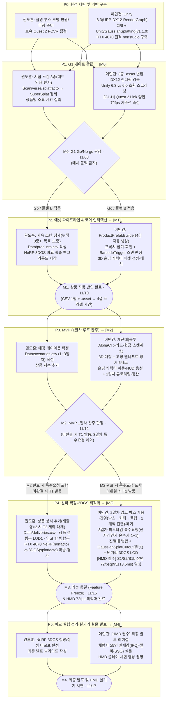

# VR 편의점 알바 시뮬레이터 — 실제 구현 마일스톤 및 실행 체크리스트

> **문서 목적**: [VR편의점_알바_시뮬레이터_구현_문서.md](file:///Users/lmg/Projects/vr-convenience-store-simulator/docs/VR편의점_알바_시뮬레이터_구현_문서.md)(5차 개정본)의 설계 계약을 실제 개발 착수부터 최종 발표까지 **즉시 실행·체크 가능한 마일스톤 단위의 작업 지시서(Actionable Backlog & DoD)**로 구체화한 문서다.
> **기준일**: 2026-10-25 (확정 결정 `D1~D9` 전수 반영) · **2026-11-06 갱신**(`D2` HMD 기종 Meta Quest 2 확정, `D10` 입고 박스 개봉·진열 추가 — 구현 문서 2.7·5.7절, `D1` **최종 발표 2026-11-17(화) 확정 → 발표일 역산 마감** — 구현 문서 8장)
> **게임 디자인 정리**: [VR편의점_알바_시뮬레이터_게임기획서.md](VR편의점_알바_시뮬레이터_게임기획서.md)

---

## 0. 절대 준수 원칙 (Hard Constraints — `D9`) 및 운영 규칙

> [!IMPORTANT]
> **타협 불가능한 3대 하드 제약 (`D9`)**
> 1. **3D 공간·입체 에셋 100% 구현**: 매장·손님·상품 전 요소를 3D로 구현한다. 원거리 진열대 등을 2D 평면 이미지('사진 판'/Quad)로 대체하는 것을 금지하며, 원거리 경량화도 반드시 **3DGS Decimation(가우시안 축소) + SH 압축(`VeryLow`)**으로만 수행한다.
> 2. **HMD(VR) 실기기 검증·시연 필수 (`D2`·`D9`)**: 평일 단위 기능 개발은 `XR Device Simulator`로 멈춤 없이 진행하되, **G1-H(실기기 게이트)·M3(기능 동결 72fps 검증)·M4(최종 발표 및 설문)**는 반드시 **Meta Quest 2 + 유선 Link(PCVR, DX12) 실기기**에서 완수한다(다른 기종 측정값은 판정에 쓰지 않음). 실기기는 **팀이 보유한 Meta Quest 2(2026-11-06 확보)**를 쓰며(구 3중 확보 경로는 고장·분실 대비 비상용), 비-VR 에디터 데모로 최종 발표를 대체하지 않는다.
> 3. **NeRF 또는 3D 가우시안 스플래팅(3DGS) 무조건 활용 (`D3`·`D9`)**: 매장 내 모든 상품 에셋은 **100% 3DGS(`Scaniverse` / `nerfstudio splatfacto`)**로 제작하고, **NeRF(`nerfstudio nerfacto`)**는 동일 촬영 데이터셋 기반 정량·정성 비교 실험(M3~M4)에 필수로 활용한다. 어떠한 경우에도 3DGS를 포기하고 일반 폴리곤 메시+텍스처로 회귀하는 **'메시 폴백'은 금지**한다.

### 전체 마일스톤 흐름 및 의존성 구조



### 마일스톤 총괄 요약표

| 단계 | 마일스톤 · 마감 | 핵심 목표 | 선행 조건 | 완료 판정 기준 (Exit Gate) | HMD 실기기 요건 |
|---|---|---|---|---|---|
| **P0** | 환경 구축 · 11/06(금) | 촬영·학습·엔진·협업 기반 완비 | 착수 | P0 체크리스트 100% 통과 | Quest 2 확보 완료 · 유선 Link 케이블·Link 앱 점검 |
| **P1** | **M0** (G1 게이트) · 11/08(일) 22:00 | 스캔 3종 품질·소요시간·렌더링·엔진 검증 | P0 완료 | 3종 라벨 판독 + ≤3h/상품 + DX12 렌더 정상 | **G1-H**: Quest 2 Link 양안·72fps 1차 실측 |
| **P2** | **M1** (자동 반입) · 11/10(화) 22:00 | CSV+`.asset` → 4겹 프리팹 자동화 & 잡기·스캔 | M0 통과 | 누적 8종 이상(목표 11종) 반입 + 에디터/시뮬레이터 스캔 성공 | 시뮬레이터 주행 + 매일 Quest 2 착용 확인 |
| **P3** | **M2** (MVP 완주) · 11/12(목) 22:00 | 1일차 근무(튜토리얼+손님 5명+결제+정산) 완주 | M1 통과 | 1일차 출근~정산 무중단 완주 (T1 판정 기준점) | 시뮬레이터 완주 + HMD 중간 점검 |
| **P4** | **M3** (기능 동결) · 11/15(일) 22:00 | 2·3일차 확장(입고 박스 개봉·진열 포함) + 진열대 4단계 최적화 + 비교학습 | M2 통과 | 전 일차 완주 + **HMD S1/S2/S1b p95 ≤ 13.5ms(72fps)** | **필수**: Quest 2 Link 72fps 절대 판정 통과 |
| **P5** | **M4** (최종 발표) · 11/17(화) | NeRF·3DGS 비교표 완성 + 설문(≥5인) + 발표 | M3 통과 | 비교표·설문·시연영상·최종 빌드·발표 리허설 완료 | **필수**: HMD 착용 설문(≥5인) 및 실기 시연 |

---

## 1. 타깃 디렉터리 및 구현 스크립트 구조 (착수 기준선)

실제 구현 시 2인 팀의 파일 경로 충돌을 막기 위해 아래 디렉터리 및 스크립트 구조를 고정한다.

```text
vr-convenience-store-simulator/
├─ capture/                                  # [.gitignore 등록 — Git LFS 제외, 외부 드라이브 공유]
│  └─ products/{id}/
│     ├─ raw/                                # 스마트폰 촬영 원본 사진 (100~180장)
│     ├─ processed/                          # nerfstudio COLMAP 전처리 결과 (splatfacto·nerfacto 공용)
│     ├─ scans/                              # 미정제 Scaniverse(.spz) / splatfacto(.ply) / nerfacto 출력
│     └─ cleaned/{id}.ply                    # SuperSplat 배경·플로터 제거 완료 표준 Binary PLY
├─ Data/                                     # [권도훈 소유 — 팀 데이터 인터페이스]
│  ├─ products.csv                           # 상품 표 (스키마 v1: 9컬럼)
│  ├─ scenarios.csv                          # 1~3일차 손님 주문 시나리오
│  └─ deliveries.csv                         # 2·3일차 입고 박스 목록 (D10 — 구현 문서 6.5절)
├─ Assets/
│  ├─ GaussianSplats/                        # [Git LFS 추적: *.ply, *.spz, *.asset, *.bytes]
│  │  ├─ Products/{id}.ply                   # 정제 완료 반입 PLY
│  │  ├─ Products/{id}.asset                 # Create GaussianSplatAsset 변환 런타임 에셋 (LOD0)
│  │  ├─ Products/{id}_LOD1.asset            # 입고 대상 상품 경량본 (≤3.5만, SH VeryLow — 박스 내용물·칸 뒷열용)
│  │  └─ Merged/                             # 진열대 칸별 병합 에셋 (Shelf_{id}_LOD0.asset, LOD1.asset)
│  ├─ Data/SO/{id}.asset                     # 자동 생성된 ④ ProductData ScriptableObject
│  ├─ Prefabs/Products/P_{id}.prefab        # 자동 생성된 4겹 상품 프리팹
│  ├─ Prefabs/Intake/P_StockBox.prefab      # 입고 박스 템플릿 (치수는 스폰 시 size_cm·case_qty로 생성)
│  ├─ Prefabs/Intake/P_BoxCutter.prefab     # 박스 커터 (날 = 레이어 Tool)
│  ├─ Scenes/StoreScene.unity                # [이민건 단독 수정] 메인 편의점 씬
│  └─ Scripts/                               # [이민건 소유 — C# 구현체]
│     ├─ Data/
│     │  ├─ ProductData.cs                   # ④ ScriptableObject 정의 + BarcodeFace enum
│     │  ├─ CatalogLoader.cs                 # Data/products.csv 파서 및 검증
│     │  ├─ DayScenarioLoader.cs             # Data/scenarios.csv 파서
│     │  └─ DeliveryLoader.cs                # Data/deliveries.csv 파서 + 칸·용량·경량본 검증
│     ├─ Editor/
│     │  └─ ProductPrefabBuilder.cs          # 메뉴 Tools/Product Prefab Builder (4겹 프리팹·SO 생성기)
│     ├─ Interaction/
│     │  ├─ ProductPrefab.cs                 # 루트 홀더 (ProductData 참조, 쿨타임, IsExpired/IsProcessed, m_RenderOrder 제어)
│     │  ├─ ScannerZone.cs                   # 바코드 트리거 충돌 판정 + 햅틱/효과음
│     │  ├─ BagZone.cs                       # 비닐봉투(Alpha Clip) 담기 판정 및 페어런팅
│     │  ├─ PaymentZones.cs                  # CardSlotZone, CashDrawer, ChangeTray 판정
│     │  ├─ TaskZones.cs                     # ShelfSlotZone(진열 — 용량·유닛 컷아웃), DisposalBinZone(폐기), MicrowaveZone, WaterDispenserZone, BoxStandSocket, BoxRecycleZone
│     │  ├─ StockBox.cs                      # 입고 박스 상태 머신(Sealed→…→Recycled) + BoxFlap + TapeCutPath + BoxUnit
│     │  └─ BoxCutter.cs                     # 커터 잡기·홀더 자동 복귀, CutterBlade 체크포인트 통과 판정
│     ├─ Gameplay/
│     │  ├─ GameManager.cs                   # 일차 진행(Intro→Shift→Settlement→DayEnd) 및 점수 정산
│     │  ├─ POSController.cs                 # 스캔 목록 합산, [-] 스캔 취소 버튼, 1+1 할인, 결제 승인 이벤트
│     │  ├─ CustomerDirector.cs              # 3D 손님 캐릭터 NavMesh 스폰·이동·바구니 배치·주문 HUD·음성
│     │  ├─ IntakeDirector.cs                # 입고 박스 스폰·중간 도착·진열 집계(완료율·오진열·정면 진열·미수거)
│     │  └─ TutorialController.cs            # 1일차 6단계 조작 체인 + 2일차 입고 안내 4단계(I1~I4)
│     └─ Rendering/
│        ├─ SplatShelfSlot.cs                # 진열대 집기/놓기 시 GaussianSplatCutout 토글 + m_RenderOrder 전환
│        └─ SplatShelfLOD.cs                 # 카메라 거리 히스테리시스(3.0m/4.0m) 기반 3DGS LOD0↔LOD1 교체
└─ docs/
   ├─ perf/perf_log.csv                      # 모든 프레임·성능 측정 통합 시트 (9.5절 스키마)
   ├─ build_log.md                           # 일일 통합 빌드 점검 1줄 기록 (11/17까지 매일)
   └─ decisions.md                           # 디스코프 트리거(T1·T2) 및 플랜 B 발동 이력
```

---

## 2. 단계별 상세 마일스톤 및 실행 체크리스트

---

### [P0] 환경 세팅 및 기반 구축 — 11/06(금)

- **목표**: 3DGS 촬영·학습·정제 도구 체인과 Unity 6.3 URP(DX12·Render Graph) + OpenXR + `UnityGaussianSplatting(v1.1.0)` 개발 환경을 완비하고, 보유 Quest 2를 유선 Link(PCVR)로 바로 쓸 수 있게 점검한다.
- **진입 조건**: 프로젝트 착수 즉시 · **마감 11/06(금) 24:00**

#### A. 권도훈 (3DGS 캡처 · 정제 · 관리 트랙)
- [ ] **P0-K1. 촬영 부스 및 반사 억제 도구 준비**: 무광 단색 배경지, 균일 확산광(LED 조명), 턴테이블(선택), 반사 재질 대비용 **소멸성/수용성 무광 스캔 스프레이** 및 스마트폰 **CPL(원형 편광) 필터** 준비.
- [ ] **P0-K2. 스마트폰 및 macOS 정제 도구 설치**:
  - 스마트폰에 `Scaniverse` 설치 및 SPZ/PLY 내보내기 동작 확인.
  - macOS에 `SuperSplat`(로컬 실행 또는 브라우저 에디터) 및 Unity 6.3 LTS(macOS Metal 검수용) 설치.
- [x] **P0-K3. HMD 실기기 확보 (`D2`·`D9`)** — **완료(2026-11-06)**: 팀이 Meta Quest 2 1대를 확보했다. 3중 확보 경로(`docs/p0/HMD_3중_확보_패키지.md`)는 고장·분실 대비 비상용으로만 보관한다.
- [ ] **P0-K3b. 보유 Quest 2 PCVR 점검 (11/06)** — Windows 쪽 설정은 이민건:
  - 유선 Link용 USB-C 케이블(USB 3 데이터 전송 지원, 3m 이상 권장) 보유 확인 — 없으면 즉시 구매.
  - Windows RTX 4070 데스크톱에 Meta Quest Link 앱 설치 → 헤드셋 연결 → Refresh Rate 72Hz 설정 → 헤드셋 펌웨어 버전 기록.
  - 헤드셋·컨트롤러 충전, 보관 담당 1명 지정(기본 보관 위치: Windows 데스크톱 옆).
- [ ] **P0-K4. 기록 문서 초기화**: `docs/perf/perf_log.csv`(헤더 생성), `docs/build_log.md`, `docs/decisions.md`, `Data/products.csv`, `Data/scenarios.csv`, `Data/deliveries.csv`(2026-11-06 추가) 빈 템플릿 커밋.

#### B. 이민건 (Unity VR · 시스템 · 원격 학습 인프라 트랙)
- [ ] **P0-L1. Unity 6.3 LTS 프로젝트 및 패키지 고정 (`2.2절`)**:
  - Unity 6.3 LTS(`6000.3.x`, Windows Build Support IL2CPP 포함) 및 폴백 대비용 Unity 6.0(`6000.0.23f1`) 설치.
  - Universal 3D(URP) 템플릿 생성 → `XR Plugin Management`, `OpenXR`, `XR Interaction Toolkit 3.x` 설치 → **Starter Assets** 및 **XR Device Simulator** 샘플 임포트.
  - Package Manager → Git URL 추가: `https://github.com/aras-p/UnityGaussianSplatting.git?path=/package#v1.1.0` (설치 후 커밋 해시 기록, 필요 시 `Packages/org.nesnausk.gaussian-splatting`으로 로컬 임베드).
- [ ] **P0-L2. 필수 그래픽스·URP·OpenXR 설정 (`2.2절 5번` — 누락 시 미렌더링)**:
  - `Project Settings → Player → Graphics APIs for Windows`: **Direct3D12만 유지**(DX11/Vulkan 제거).
  - 사용 중인 `UniversalRendererData`(`PC_Renderer.asset`) Inspector: **`Add Renderer Feature → Gaussian Splat URP Feature` 등록**.
  - `Project Settings → Graphics → URP → Render Graph`: **`Compatibility Mode (Render Graph Disabled)` 체크 해제(OFF)**.
  - `URP Asset`: **MSAA = Off**, Render Scale = `1.0`, Additional Lights/Shadows 최소화(무조명 파이프라인).
  - `Project Settings → XR Plug-in Management → OpenXR(PC 탭)`: **Oculus Touch Controller Profile**(Quest 2 컨트롤러 — 구현 문서 2.7절) 추가, Stereo Rendering Mode(`Multi-pass` 기본) 설정.
- [ ] **P0-L3. 물리 레이어(Layer) 및 태그(Tag) 생성 (`4.3절`, `5.1절`)**:
  - 레이어 등록: `Splat`, `Interactable`, `BarcodeFace`, `Scanner`, `Zone`.
  - 태그 등록: `Barcode`.
  - `Project Settings → Physics → Layer Collision Matrix`:
    - `Splat` 행 전체 체크 해제(물리/레이캐스트 완전 제외).
    - `BarcodeFace`는 오직 `Scanner`와만 충돌 체크.
- [ ] **P0-L4. Windows RTX 4070 데스크톱 원격 학습 환경 구축 (`D3`)**:
  - 맥북 ↔ 집 데스크톱(RTX 4070) 원격 연결(RDP/Parsec/SSH) 구성.
  - CUDA Toolkit + Conda 환경 내에 `nerfstudio`(`splatfacto` 및 `nerfacto` 포함) + `colmap` 설치 및 샘플 데이터셋 학습·내보내기(`ns-export gaussian-splat`) 동작 확인.
- [ ] **P0-L5. Git LFS 및 `.gitignore` 구성 (`2.6절`)**:
  - `.gitignore`에 `capture/`, `[Ll]ibrary/`, `[Tt]emp/`, `[Bb]uilds/` 등록.
  - `.gitattributes`에 `*.ply`, `*.spz`, `Assets/GaussianSplats/**/*.asset`, `Assets/GaussianSplats/**/*.bytes` LFS 추적 등록.

#### C. P0 완료 판정 기준 (Exit Criteria)
- [ ] Windows 에디터(DX12)에서 샘플 `.ply` 1종을 `Tools → Gaussian Splats → Create GaussianSplatAsset`으로 변환해 씬에 띄웠을 때 정상 렌더링되고, `XR Device Simulator`로 카메라 이동이 가능함.
- [ ] 고정 커밋의 `LICENSE` 파일 내 INRIA 비상업 조항 확인 완료(`3.9절`).
- [ ] RTX 4070 데스크톱에서 `ns-train splatfacto` 및 `ns-train nerfacto` CLI가 에러 없이 구동됨.

---

### [P1 / M0] G1 Go/No-go 게이트 검증 — 11/07(토)~11/08(일)

- **목표**: 대표 재질 3종(매트·인쇄·반사)의 실제 3DGS 복원 품질·상품당 소요 시간·Unity 6.3 DX12 렌더링·Quest 2 Link 실기기 양안 72fps(`G1-H`)를 실측하여 파이프라인 성립을 확정한다.
- **진입 조건**: P0 완료 · **M0 판정 11/08(일) 22:00**

#### A. 권도훈 (시험 스캔 3종 캡처 · 정제 · 시간 실측)
- [ ] **P1-K1. 시험 스캔 3종 촬영 (`3.2절`, `9.1절`)**:
  - 대상 3종: ① **매트 재질**(과자 봉지 1종) ② **고밀도 인쇄 재질**(삼각김밥 랩 1종) ③ **반사/투명 재질**(페트병 또는 알루미늄 캔 1종 — 측면 차폐 + 필요 시 무광 스프레이/편광 필터 적용).
  - 촬영 프로토콜: 수평 2바퀴(눈높이 + 상방 45°) + 앞뒤·양옆 근접 + **바코드 면 필수 근접 촬영**(상품당 사진 100~150장, 반사 재질 150~180장).
  - **매트·반사 2종의 사진 원본 세트는 `capture/products/{id}/raw/`에 그대로 보관**한다 — 11/09부터 NeRF·3DGS 비교 학습(P2-K3)에 쓴다.
- [ ] **P1-K2. 1차 Scaniverse & 2차 `splatfacto` 학습 (`3.3절`)**:
  - 3종 모두 Scaniverse로 1차 생성.
  - 반사 재질(또는 라벨 흐림 발생 품목)은 RTX 4070 원격 접속으로 `ns-train splatfacto` 실행 후 `.ply` 추출.
- [ ] **P1-K3. SuperSplat 정제 및 시간 예산 기록 (`3.4절`, `3.8절`)**:
  - 배경 컷아웃 → 플로터 제거 → 알파 컬링(Alpha < 0.15 제거) → 피벗 중심 정렬 → **표준 Binary `.ply`**로 `capture/products/{id}/cleaned/{id}.ply` 내보내기(정제 후 가우시안 수 **≤15만** 확인).
  - 3종 각각의 `[촬영(분) / 학습(분) / 정제·변환(분) / 합계(시간)]`을 측정하여 상품당 처리 시간 **≤3시간** 달성 여부 확인.

#### B. 이민건 (엔진 호환 검증 · `G1-H` HMD 실기기 측정)
- [ ] **P1-L1. 시험 스캔 3종 Unity 반입 및 에디터 렌더링 검증 (`G1-c`)**:
  - 정제된 3종 `.ply`를 `Assets/GaussianSplats/Products/`에 반입 후 `Create GaussianSplatAsset`(Quality: `Medium`)으로 `.asset` 생성.
  - 계산대 목업 씬의 파지 거리(~50cm)에 배치하여 브랜드명·가격 숫자·바코드 영역 가독성 확인(`G1-a`).
- [ ] **P1-L2. Unity 6.3 vs 6.0 VR 호환 스크리닝 (`G1-d`, `2.5절`)**:
  - Unity 6.3에서 스플랫 렌더링 및 XRI 기본 Grab 인터랙션 이상 유무 확인.
  - 이상 징후(검은 화면·한쪽 눈 미표시·크래시) 발견 시 즉시 Unity 6.0(`6000.0.23f1`)에서 동일 씬을 열어 비교하고 폴백 여부 결정.
- [ ] **P1-L3. `[G1-H]` Quest 2 Link HMD 실기기 검증 (`9.1절` — 필수)**:
  - 보유 Quest 2 + 유선 Link(Meta Quest Link 앱 Refresh Rate 72Hz 고정, Windows DX12 빌드) 연결. Render Resolution 설정값·헤드셋 펌웨어 버전 기록.
  - 대표 장면(진열대 1칸 정면 1m + 상품 2개 파지 근접 30cm)에서 **30초 × 3회** 프로파일링 → `docs/perf/perf_log.csv`에 `device=quest2-link`로 기록.
  - 양안 입체 정렬 이상 유무(`Multi-pass` vs `Single Pass Instanced`), Oculus Touch 컨트롤러 6자유도 트래킹, 5분 착용 시 멀미 유무 확인.
  - Quest 2 착용 상태에서 ~50cm 라벨 판독(`G1-a` HMD 판정)과 HUD 글자 크기(시각 1.2° 초기값) 판독성 확정 — 에디터 확대 캡처 결과와 따로 기록(구현 문서 2.7절).

#### C. M0 완료 판정 기준 (G1 Gate Criteria) 및 플랜 B 즉시 조치
- [ ] **G1-a (스캔 품질)**: 3종 모두 ~50cm 거리에서 브랜드명+가격 숫자 판독 가능.
  - *미달 시 조치*: 반사 재질에 무광 스프레이/편광 필터 재적용 + `splatfacto` 30k step 학습(총 3회 촬영 후에도 불량인 특정 용기만 스캔 우호적 다른 실물 상품으로 대체 — **메시 폴백 절대 금지**).
- [ ] **G1-b (처리 시간)**: 재촬영 제외 상품당 합계 **≤3시간** (초과 시 정제 작업 2인 분담).
- [ ] **G1-c / G1-d (렌더링·엔진)**: DX12 정상 렌더링 및 XRI 잡기 정상 작동 (실패 시 1일 내 Unity 6.0 LTS로 프로젝트 이식).
- [ ] **G1-H (HMD 실기기 성능)**: Quest 2 Link 30초×3회 **평균 72fps 이상, 프레임 드롭 < 5%**.
  - *미달 시 조치*: OpenXR Render Viewport Scale `0.85 → 0.7` 축소 + URP FSR 활성화 + 알파 컬링 상향(`0.25`) + SH 압축 `Low`/`VeryLow` 적용 후 재측정.

---

### [P2 / M1] 에셋 파이프라인 가동 및 코어 VR 인터랙션 — 11/09(월)~11/10(화)

- **목표**: `Data/products.csv`와 정제 `.asset`만으로 4겹 상품 프리팹을 자동 생성하는 에디터 파이프라인을 완성하고, 손으로 상품을 집어 돌려 바코드를 스캔하는 코어 VR 메커니즘을 구현한다.
- **진입 조건**: M0(G1 게이트) 통과 · **M1 마감 11/10(화) 22:00**

#### A. 권도훈 (지속 상품 스캔 · 정제 · `Data/products.csv` 구축)
- [ ] **P2-K1. 1차 본 물량 상품 촬영·학습·정제 (11/10까지 누적 8종 이상, 목표 11종)**:
  - 게이트에서 검증된 촬영·조명 조건으로 컵라면·삼각김밥·과자·음료·즉석식품 등 지속 촬영.
  - S1 촬영 → S2 Scaniverse(불량 시 RTX 4070 `splatfacto`) → S3 SuperSplat 정제(가우시안 수 **≤10만** 목표) → `.ply` 및 Unity `.asset` 변환.
  - 재촬영 2회(총 촬영 3회) 초과 시 미련 없이 `status=dropped` 기록 후 다른 실물 상품으로 대체(`T2` 규칙).
- [ ] **P2-K2. 상품 표 `Data/products.csv` 작성 (`4.1절`)**:
  - 9컬럼 규격(`id,name,price,size_cm,barcode_face,splat_path,scan_source,retake_count,status`)에 맞춰 줄자 실측 크기(W·D·H cm)와 바코드 위치(`bottom`/`back`/`side`)를 정확히 기입하고 `status=cleaned`로 커밋.
- [ ] **P2-K3. NeRF·3DGS 비교 학습 백그라운드 시작 (`9.3절` — 11/09 시작)**:
  - G1 시험 스캔의 매트·반사 2종 사진 세트로 COLMAP 포즈 계산(`ns-process-data`) → 동일 포즈·동일 test split(8장)으로 `ns-train nerfacto`·`ns-train splatfacto`를 RTX 4070에서 순차 실행(원격 접속, 상품 반입 작업과 병렬).
  - 학습 시간(분)·산출물 용량(MB)을 기록해 두고, `ns-eval`·비교 캡처는 P4-K2(11/15까지)에서 마무리.

#### B. 이민건 (자동 프리팹 빌더 · 잡기/회전 · 바코드 스캔 · 손님 에셋)
- [ ] **P2-L1. 데이터 모델 및 파서 구현 (`4.1~4.4절`)**:
  - `ProductData.cs`: `ScriptableObject` (`Id`, `Name`, `Price`, `SizeCm`, `BarcodeFace` enum, `SplatAsset`, `OrderCatalogFlags`).
  - `ProductPrefab.cs`: 루트 `MonoBehaviour` (`ProductData Data`, `bool IsExpired`, `bool IsProcessed`, `TryMarkScanned()`, `SetSplatRenderOrder(int order)`).
  - `CatalogLoader.cs`: `Data/products.csv` 파싱(주석 `#` 무시, `size_cm` 구분자 `·`/`x`/`X` 파싱, 필수 컬럼 누락·미정의 컬럼 경고 로그).
- [ ] **P2-L2. 4겹 프리팹 자동 생성기 구현 (`ProductPrefabBuilder.cs`, `4.3~4.6절`)**:
  - 에디터 메뉴 `Tools → Product Prefab Builder` 구현(`status=cleaned` 행 대상, `retake_count > 2` 행은 경고 후 제외).
  - 루트 `P_{id}`(레이어 `Interactable`): `Rigidbody`(0.1~1.0kg, Interpolate, Continuous Dynamic) + `XRGrabInteractable`(Velocity Tracking) + `ProductPrefab` + ② 프록시 `BoxCollider`(`size_cm / 100f`).
  - 자식 ① `Splat`(레이어 `Splat`): `GaussianSplatRenderer` 부착, `GaussianSplatAsset.boundsMin/Max` 기반 균일 스케일 `s = median(rx, ry, rz)` 및 중심 정렬 적용(축별 비율 편차 > ±10% 시 경고 후 중단).
  - 자식 ③ `BarcodeTrigger`(레이어 `BarcodeFace`, 태그 `Barcode`): 지정 면(`bottom=-Y`, `back=-Z`, `side=+X`) 안쪽에 면적 100% × 두께 0.02m 트리거 박스 부착(프록시 내부 완전 포함 검증).
  - 자동 검증 게이트 6항목 통과 시 `Assets/Data/SO/{id}.asset` 및 `Assets/Prefabs/Products/P_{id}.prefab` 저장.
- [ ] **P2-L3. 잡기·회전 및 바코드 스캔 판정 구현 (`5.2~5.3절`)**:
  - `ScannerZone.cs`: `OnTriggerEnter`에서 `c.GetComponentInParent<ProductPrefab>()` 참조 → 쿨타임(0.8초) 검사 → '삑' 3D 공간음 + 스캐너 라이트 점멸 + 컨트롤러 햅틱(0.6f, 0.1초) + 스캔 이벤트 발행.
  - 바닥 낙하 상품 3초 후 원위치 리스폰 안전장치 추가.
- [ ] **P2-L4. 손님 3D 캐릭터 에셋 조달 및 기본 애니메이션 세팅 (`6.1절`, `D4`)**:
  - Unity Asset Store 무료 스타일라이즈드 인간형 NPC(또는 Mixamo 캐릭터) 임포트.
  - `Animator Controller`에 `idle`, `walk`, `leave` 3개 상태 연결 및 `NavMeshAgent` 프로토타입 이동 확인.

#### C. M1 완료 판정 기준 (Exit Criteria)
- [ ] `Data/products.csv`에 `status=cleaned` 행을 추가하고 `Tools → Product Prefab Builder`를 클릭하면 4겹 프리팹과 SO가 에러 없이 생성되고 자동 검증 게이트(스케일 오차 ±5% 이내, 트리거 내부 포함 등)를 통과함.
- [ ] 누적 **8종 이상(목표 11종)**의 실제 편의점 상품 3DGS 프리팹이 씬에 배치되고, 상품을 집어 바코드 면을 스캐너에 대면 '삑' 소리와 함께 상품명·가격이 콘솔/임시 UI에 정확히 찍힘.

---

### [P3 / M2] MVP — 1일차 근무 루프 및 매장 완주 — 11/11(수)~11/12(목)

- **목표**: 3D 편의점 매장·계산대(봉투·카드·현금·거스름돈·스캔 취소)·3D 손님 캐릭터·주문 HUD·1일차 6단계 튜토리얼·하루 정산을 모두 연결하여 **1일차 근무(튜토리얼 + 손님 5명)를 처음부터 끝까지 완주**한다.
- **진입 조건**: M1 통과 · **M2 마감 11/12(목) 22:00 = T1 판정점**

#### A. 권도훈 (매장 레이아웃 · 주문 시나리오 `Data/scenarios.csv` · 오디오 · 지속 스캔)
- [ ] **P3-K1. 매장 레이아웃 치수 및 텔레포트 포인트 확정 (`슬라이드 12`, `5.1절`)**:
  - 음료 냉장고(상단), 진열대 A/B/C(좌측 3단), 전자레인지·온수기(우상단), 계산대(우중앙), 폐기함(우하단), 입구(좌하단) 동선 및 카메라-진열대 거리 확정.
  - 입고 동선 자리 확보(D10 — 기능 구현은 P4): 창고 입구(입고 카트·빈 박스 수거함, 앵커 ⑥) 위치, 진열대 A·B/C 앞 허리 높이(0.8m) 박스 거치대 자리, 진열대 칸 코드(`A-1`, `A-2` … 진열대 문자-칸 번호) 부여.
- [ ] **P3-K2. 주문 시나리오 데이터 `Data/scenarios.csv` 작성 (`6.3절`, `6.5절`)**:
  - 1일차(손님 5명, 스폰 간격 10초, 제한시간 150초, 이탈 없음), 2일차(손님 8명, 15초, 120초), 3일차(손님 12명 — 일반 20초/90초, 피크 9~12번째 10초/60초, 특수 요청 포함) 시나리오 행 작성.
- [ ] **P3-K3. 사운드 클립 조달 (`5.1절`, `6.1절`)**:
  - 효과음 5종('삑', '띠르릉', '철컥', '땡', 취소음 '띡') + 매장 환경음 + 입구 도어벨 + 손님 음성(인사 2종, 재촉 1종, 이탈 1종, 특수 요청 4종) + 튜토리얼 안내 음성 6종 확보.
- [ ] **P3-K4. 상시 트랙 — 상품 추가 스캔 및 정제 계속 (`D5`)**.

#### B. 이민건 (3D 매장 · 텔레포트 앵커 · 계산대 결제 · 손님 루프 · 튜토리얼)
- [ ] **P3-L1. 3D 매장 환경 및 고정 `TeleportationAnchor` 6개소 구축 (`5.1절`)**:
  - 3D 매장 메시(진열대 A/B/C, 음료 냉장고, 계산대, 전자레인지, 온수기, 폐기함, 창고 입구) 배치 및 손님 이동용 `NavMesh` 베이크.
  - 멀미 방지를 위해 연속 이동(Continuous Move)을 끄고 고정 **`TeleportationAnchor` 6개소**(① 계산대 정면, ② 진열대 A, ③ 진열대 B/C, ④ 냉장고, ⑤ 전자레인지·온수기·폐기함, ⑥ 창고 입구 — 입고 카트·빈 박스 수거함) + `Snap Turn(45°)` 설정.
- [ ] **P3-L2. POS 컨트롤러·스캔 취소·비닐봉투·카드/현금 결제 구현 (`5.3~5.5절`)**:
  - `POSController.cs`: 스캔 품목 리스트업, 합계 계산, 각 품목 행 우측 **`[−]` 취소 버튼**(`XRPokeInteractor`/`XRRayInteractor` 클릭 시 1건 차감).
  - `BagZone.cs`: **URP Lit + Alpha Clipping(컷아웃)** 셰이더를 적용한 비닐봉투 메시(반투명 블렌딩 금지) + 진입 후 속도 ≤0.5m/s 0.3초 유지 시 `Bagged` 페어런팅(물리 비활성, 스플랫 렌더 유지).
  - `PaymentZones.cs`:
    - 카드 결제: 손님 카드를 집어 `CardSlotZone`에 0.5초 삽입 시 '띠르릉' 승인.
    - 현금 결제: 손님 지폐를 `CashDrawer`에 투입 → POS에 거스름돈 자동 표시 → 100·500·1,000·5,000원 화폐 프리팹을 집어 `ChangeTray`에 놓아 금액 일치 시 완료(오류 시 '땡' + 현재 금액 표시).
- [ ] **P3-L3. 손님 디렉터 및 근무 상태 머신 구현 (`6.1~6.2절`, `6.5절`)**:
  - `DayScenarioLoader.cs`: `Data/scenarios.csv` 로드 및 `CatalogLoader`와 상품 ID 조인 검증.
  - `CustomerDirector.cs`: 시나리오에 따라 3D 손님 캐릭터 스폰 → 입구에서 계산대 앞까지 `NavMeshAgent` 이동 → 도착 시 바구니(주문 3DGS 상품 포함) 카운터 분리 배치 + 인사 음성 + 월드스페이스 주문 HUD 갱신 → 결제 완료 또는 타임아웃 시 퇴장 이동.
  - `GameManager.cs`: `Intro → Shift → Settlement → DayEnd` 루프 및 정산 화면(매출 합계, 이탈 손님 수, 오스캔 횟수, 등급 S/A/B/C) 출력.
- [ ] **P3-L4. 1일차 6단계 튜토리얼 구현 (`TutorialController.cs`, `5.6절`)**:
  - T1(잡기) → T2(회전해 바코드 찾기) → T3(스캔) → T4(봉투 담기) → T5(카드 결제) → T6(현금 거스름돈: 2회 오류 시 조합 힌트, 3회 오류 시 자동 완료) 순차 진행 및 무행동 시 하이라이트 힌트 제공.

#### C. M2 완료 판정 기준 (MVP Exit Criteria & 디스코프 `T1` 판정점)
- [ ] **MVP 완주**: 1일차 시작 → 6단계 튜토리얼 통과 → 손님 5명 순차 방문(바코드 스캔·봉투 담기·카드/현금 결제) → 1일차 정산 화면(S~C 등급 표시)까지 에러나 막힘 없이 1회 이상 완전 클리어.
- [ ] **디스코프 트리거 `T1` 판정 (`8.5절`)**:
  - M2가 정상 완료되면 P4에서 3일차 특수 요청(`microwave`, `hotwater`, `oneplus`) 구현에 착수한다.
  - 만약 P4 진입 시점에 M2 핵심 루프에 미해결 결함이 남아 있으면 즉시 `T1`을 발동(`docs/decisions.md` 기록 후 `Data/scenarios.csv`의 `special` 열을 일괄 `none`으로 변경)하여 M2 안정화와 72fps 최적화에 공수를 집중한다.

---

### [P4 / M3] 알파(2·3일차 확장) · 진열대 3DGS 4단계 최적화 · 기능 동결 — 11/13(금)~11/15(일)

- **목표**: 2일차(입고 박스 개봉·진열·폐기)와 3일차(피크타임·중간 입고·특수 요청)를 완성하고, 진열대 병합·`GaussianSplatCutout`(유닛 컷아웃 포함)·원거리 3DGS LOD·오버드로 완화책을 적용하여 **Quest 2 Link 실기기에서 72fps(p95 ≤ 13.5ms)를 달성**한 뒤 기능을 동결(Feature Freeze)한다. 또한 NeRF vs 3DGS 비교 학습을 수행한다.
- **진입 조건**: M2 통과 · **T3 판정 11/14(토) 18:00 · M3 기능 동결 11/15(일) 22:00**
- **순서**: 11/13~14 2일차(입고 박스·폐기) → 11/14~15 3일차(피크·특수 요청) → 11/15 병합·컷아웃·LOD 적용 + HMD 측정 + 플레이테스트

#### A. 권도훈 (진열대 병합 에셋 제작 · NeRF vs 3DGS 비교 학습 · 상시 스캔)
- [ ] **P4-K1. 진열대 칸별 병합 에셋(`LOD0`) 및 원거리 경량 에셋(`LOD1`) 제작 (`7.3절 2·4단계`)**:
  - 진열대 칸 단위로 2~3종 상품 `.ply`를 SuperSplat에서 멀티 임포트·배치 후 단일 `.ply`로 병합(칸당 가우시안 수 **≤30만**). 입고 대상 칸은 P4-K4 규칙(용량 전체 진열 상태)으로 만든다.
  - Unity `Create GaussianSplatAsset`으로 근거리용 `Assets/GaussianSplats/Merged/Shelf_{id}_LOD0.asset`(Quality: `Medium`) 생성.
  - 원거리(3.5m+) 칸용으로 SuperSplat에서 가우시안 수를 25~50%로 Decimation한 뒤 `Create GaussianSplatAsset`의 **`VeryLow` SH 압축 포맷**을 적용해 `Shelf_{id}_LOD1.asset` 생성(**2D 사진 판 사용 절대 금지 — `D9`**).
- [ ] **P4-K2. NeRF(`nerfacto`) vs 3DGS(`splatfacto` / `Scaniverse`) 비교 실험 평가 (`9.3절` — 필수, 학습은 P2-K3에서 11/09 시작 · `ns-eval` 수치 11/15까지)**:
  - 대표 상품 최소 2종(매트 1종·반사 1종)의 동일 사진 원본 세트(`raw/`) + 동일 COLMAP 카메라 포즈(`processed/`) + 동일 test split(8장)을 RTX 4070에 투입.
  - `ns-train splatfacto` 및 `ns-train nerfacto` 실행 → 학습 소요 시간(분) 및 산출물 용량(MB) 기록.
  - `ns-eval` 실행으로 **PSNR · SSIM · LPIPS** 정량 수치 추출 및 동일 시점 라벨 텍스트·바코드 렌더링 비교 이미지 캡처.
- [ ] **P4-K3. 상시 트랙 — 신규 상품 지속 추가 및 칸 재병합 (`D5`)**.
- [ ] **P4-K4. 입고 데이터·경량본·입고 칸 병합본·사운드 (`D10`, 구현 문서 `4.6`·`5.7`·`6.5`·`7.2절`)**:
  - `Data/deliveries.csv` 작성: 2일차 박스 2개(6입·4입, 시작 시 입고), 3일차 박스 2개(6입 시작 시 + 4입 6번째 손님 뒤 중간 도착). 같은 일차·같은 칸의 `case_qty` 합계 ≤ 칸 용량.
  - 입고 대상 상품마다 경량본 생성: 정제 `.ply` → SuperSplat Decimation(가우시안 ≤3.5만) → `{id}_LOD1.ply` → `Create GaussianSplatAsset`(SH `VeryLow`) → `Assets/GaussianSplats/Products/{id}_LOD1.asset`.
  - 입고 대상 칸 병합본: 칸 용량(4~8유닛)이 **모두 진열된 상태**로 병합 — 앞열 유닛은 상품당 ≤5만으로 Decimation, 뒷열 유닛은 경량본 배치(칸 ≤30만). 유닛 자리 좌표를 이민건에게 전달(유닛 컷아웃 배치용).
  - 입고 효과음 5종('툭' 거치·'찌익' 테이프·'펄럭' 플랩·'착' 진열·'털썩' 수거) + 배송 도착 알림음 + 2일차 입고 안내 음성 4종(I1~I4) 확보.
- [ ] **P4-K5. 11/15 플레이테스트 (게임 기획서 18장)**:
  - 팀 외 체험자 1~2명(가능하면 HMD, 아니면 시뮬레이터)으로 1~3일차 1회 플레이 → 상품당 스캔 시간·힌트 발동·2일차 이탈 수·과제 완료율 기록.
  - 결과로 `Data/scenarios.csv`·`Data/deliveries.csv` 수치와 정산 점수식·등급 경계(게임 기획서 11장 [제안])를 확정하고 구현 문서 6.3·6.5절에 반영.

#### B. 이민건 (2·3일차 확장 과제 · 컷아웃/LOD 시스템 · HMD 72fps 최적화)
- [ ] **P4-L1. 2일차 입고 박스 개봉·진열(`restock`) 및 유통기한 폐기(`dispose`) 구현 (`5.7절`, `6.4절`)**:
  - 선행 확인(착수 첫날): 칸 1개·박스 1개 규모로 ① 박스 벽(불투명 메시) 뒤 경량 스플랫 가림 ② 유닛 컷아웃 경계 품질을 먼저 확인(구현 문서 7.3절).
  - 프로젝트 설정: 레이어 `Tool`(13번) 추가, 충돌 매트릭스 `Tool` ↔ `Zone`만 허용.
  - `DeliveryLoader.cs`: `Data/deliveries.csv` 로드 + 검증 6항목(live 상품·칸 존재/상품 일치·`case_qty ∈ {4,6,8}`·칸 용량·도착 순번·경량본 존재) + `"처리 N건 / 스킵 M건"` 요약 로그.
  - `StockBox.cs`: `Sealed → Carried → Docked → TapeCut → Open → Empty → Recycled` 상태 머신. `StockBox.Build(ProductData, caseQty)`로 단층 치수 생성(내부 = 열×W+1cm × 행×D+1cm × H+1cm), 손잡이 `HandleL/R`로만 잡기(`XRGrabInteractable` Movement Type Instantaneous, 2kg), 측면 TextMeshPro 라벨(상품명 ×수량·대상 칸).
  - `BoxFlap`: 손 위치 투영 각도로 0~210° 회전, 놓을 때 110° 이상 완전 개방 스냅, 보조 플랩 연동. `TapeCutPath`: 체크포인트 6개 순서 통과(양방향, 간격 2초 이내), `Docked`에서만 판정. `BoxCutter.cs`: 놓으면 1초 후 홀더 복귀.
  - `BoxUnit`: 경량 스플랫 유닛을 잡으면 렌더러 끄고 풀의 원본 4겹 프리팹으로 선택 이양(`m_RenderOrder = 10`), 낙하·오진열 시 유닛 자리로 리스폰.
  - `ShelfSlotZone` 확장: `slotId`·`productId`·`capacity`·`unitPoses`·`unitCutouts`, 수용 판정(상품 일치·잔여 용량·존 안 SelectExit) → 0.15초 스냅 → `SlotRenderMode`(`Individual` = kinematic 고정 / `Merged` = 디스폰 + 유닛 컷아웃 해제). 오진열·만석 '땡'. 정면 진열(앞면 ±60°) 집계.
  - `BoxStandSocket`(앵커 ②③, 허리 높이 0.8m)·`BoxRecycleZone`(앵커 ⑥), 동시 개봉 1개 규칙, `IntakeDirector.cs`(시작 입고·중간 도착 스폰·알림, 진열 집계 → 정산 항목 4종).
  - 2일차 입고 안내 I1~I4(`TutorialController` — `IntakeTutorialStep`), 첫 손님 스폰은 I4 완료 또는 90초 후.
  - 유통기한 폐기: 일차 시작 시 무작위 3개 슬롯(그 일차 입고 대상 칸 제외) 상품에 만료 마커(`IsExpired = true`) 부여 → 플레이어가 집어 `DisposalBinZone`(폐기함)에 넣으면 폐기 카운트 +1(정상 상품 투입 시 '땡' + 오탐 감점).
- [ ] **P4-L2. 3일차 피크타임 및 특수 요청 3종 구현 (`6.3~6.4절`, `T1` 미발동 시)**:
  - `oneplus`(1+1): 동일 상품 2개 스캔 시 `POSController`에서 1개 가격만 합산.
  - `microwave`(전자레인지): 스캔 완료 상품을 `MicrowaveZone`에 투입 시 3초 작동음+조명 후 '땡' 완료음과 함께 `IsProcessed = true` 부여.
  - `hotwater`(컵라면 온수): 스캔 완료 컵라면을 `WaterDispenserZone`에 투입 시 2초 물 붓는 효과음 후 `IsProcessed = true` 부여.
  - 손님 이탈 3명 도달 시 해당 일차 즉시 정산 전환 로직 연결.
- [ ] **P4-L3. 진열대 `GaussianSplatCutout`(Invert) 분리 + `m_RenderOrder` + 원거리 3DGS LOD 구현 (`7.3절 3·4단계`)**:
  - `SplatShelfSlot.cs`: 진열대 병합 `GaussianSplatRenderer.m_Cutouts` 배열에 슬롯별 `GaussianSplatCutout`(`m_Type = Box`, `m_Invert = true`) 등록(경계 마진 +5~10mm 조절). 상품을 집는 순간 `slotCutout.enabled = true`로 칸에서 숨기고, 손에 든 개별 상품의 **`GaussianSplatRenderer.m_RenderOrder = 10`**(병합 진열대는 `0`)으로 상향해 겹침 역전 차단.
  - `SplatShelfLOD.cs`: 플레이어 카메라(XR Origin)와 진열대 칸 거리 기준 히스테리시스(**3.0m 진입 시 `LOD0` ↔ 4.0m 이탈 시 `LOD1`**) 자동 교체.
- [ ] **P4-L4. `[HMD 필수]` 4단계 최적화 전후 S1/S2 실기기 프레임 측정 및 오버드로 완화 (`7.1절`, `7.4절`)**:
  - Quest 2 Link 실기기(`device=quest2-link`)에서 S1(진열대 30cm 근접)·S2(계산대 시점)·S1b(입고 진열 시점 — 개봉 박스 8입 + 유닛 컷아웃 활성 칸 + 손에 상품 1개) 각각 **60초 × 3회** 측정하여 `docs/perf/perf_log.csv`에 단계별(개별 배치 → 병합 → 컷아웃/LOD → Viewport Scale + FSR) 기록.
  - **p95 프레임타임 ≤ 13.5ms (평균 ≥ 72fps), 드롭률 < 1%** 달성 인자 확정.
  - 같은 HMD 세션에서 입고 조작감 확인: 박스를 잡은 채 텔레포트(튕김 없음), 커터 긋기·플랩 젖히기 성공률. 운반이 불안정하면 입고 카트를 대상 진열대 앞에 두는 축소안 적용 후 `docs/decisions.md` 기록.

#### C. M3 완료 판정 기준 (Feature Freeze & HMD 72fps Gate)
- [ ] 1일차 → 2일차(입고 안내 + 박스 2개 개봉·진열·수거) → 3일차(중간 입고 포함, 누적 정산 리포트 포함) 전체 게임플레이 루프가 크래시나 진행 불가(S0/S1) 버그 없이 완주됨.
- [ ] **Quest 2 Link 실기기 측정 결과 S1/S2/S1b 세 대표 장면 모두 p95 프레임타임 ≤ 13.5ms(72fps 유지) 및 가시 스플랫 합계 ≤ 150만 예산 이내** 달성 완료.
- [ ] NeRF(`nerfacto`) vs 3DGS(`splatfacto` / `Scaniverse`) 학습 및 `ns-eval` 데이터 확보 완료.
- [ ] **디스코프 `T3` 판정 (11/14 18:00)**: 2일차 입고 흐름 미완결 시 `T3` 발동(`docs/decisions.md` 기록) — 3.2절.
- [ ] **기능 동결 선언**: 11/15(일) 22:00 이후 신규 시스템 추가를 금지하고 S1 이상 버그 수정과 폴리싱만 수행.

---

### [P5 / M4] NeRF·3DGS 비교 정리 · HMD 실재감/멀미 설문 · 최종 발표 — 11/16(월)~11/17(화)

- **목표**: NeRF vs 3DGS 비교 실험 결과표와 HMD 착용 체험자 설문(≥5인) 데이터를 완성하고, 시연 영상 및 최종 발표 리허설을 마무리하여 HMD 실기기 시연과 함께 최종 발표를 완수한다.
- **진입 조건**: M3(기능 동결) 통과 · 11/16(월) 오전 시연 영상 → 오후 설문 ≥5인 → 저녁 리허설, **11/17(화) 현장 셋업·리허설 후 M4 최종 발표**

#### A. 권도훈 (비교 실험 분석표 · 설문 집계 · 발표 자료)
- [ ] **P5-K1. NeRF · 3DGS 비교 실험 최종 결과표 및 시각 자료 작성 (`9.3절`)**:
  - 3경로(`nerfacto` vs `splatfacto` vs `Scaniverse`) × 상품 2종 이상의 **① PSNR/SSIM/LPIPS 및 라벨 가독성 ② 학습·정제 시간 ③ 에셋 용량(MB)·가우시안 수 ④ 실시간 VR 렌더링 프레임타임(ms/frame, FPS)** 비교표 완성("실시간 VR HMD 72fps 구동에 왜 3DGS가 필수적인가"를 정량 입증).
- [ ] **P5-K2. HMD 착용 실재감(IPQ)·멀미(SSQ) 설문 진행 및 집계 (`9.4절` — HMD 필수)**:
  - 체험자 **최소 5인** 대상 Quest 2 HMD 착용 플레이(10~15분) 전후 설문 실시(착용 전 IPD 3단계 조정·안경 스페이서 확인):
    - 사전·사후 SSQ(16문항) 멀미 점수 변화 집계.
    - 사후 IPQ(14문항 7점 척도) + 3DGS 상품 특화 3문항(실제 상품 유사도·라벨 가독성·실측 크기 체감) 점수 집계.
- [ ] **P5-K3. 최종 발표 슬라이드 작성**:
  - 4겹 프리팹 구조, 진열대 4단계 최적화 전후 `perf_log.csv` 그래프, NeRF vs 3DGS 비교표, IPQ/SSQ 설문 결과, 디스코프/리스크 관리 기록(`docs/decisions.md`) 반영.

#### B. 이민건 (최종 마스터 빌드 · 시연 영상 촬영 · HMD 현장 리허설)
- [ ] **P5-L1. 마스터 빌드(Release, Windows DX12 IL2CPP) 제작 및 안정성 검증**:
  - S0/S1 잔여 버그 0건 확인, 씬 로드 10초 이내, 비정상 조작(상품 던지기·중복 스캔·결제 중 이탈 등) 예외 처리 최종 점검.
- [ ] **P5-L2. HMD 플레이 시연 영상 촬영 (1080p/60fps)**:
  - Quest 2 Link 미러링 화면 + 플레이어 외부 모습(PIP)으로 ① 1일차 튜토리얼·바코드 회전 스캔·봉투·카드/현금 결제 ② 2일차 입고 박스 운반·테이프 절단·플랩 개방·한 개씩 진열(유닛 `GaussianSplatCutout` 작동)·유통기한 폐기 ③ 3일차 피크타임·특수 요청·최종 정산 하이라이트 녹화.
- [ ] **P5-L3. 최종 발표 현장 HMD 실기기 리허설**:
  - 발표 환경에서 RTX 4070 데스크톱(또는 시연 PC) + Quest 2 유선 Link 연결 상태, 가디언(경계선) 세팅, 오디오 출력, 2인 발표 호흡 리허설 2회 이상 수행.

#### C. M4 완료 판정 기준 (Final Release Criteria)
- [ ] **3D 공간 + HMD(VR) 실기기 구동 + NeRF/3DGS 활용(비교 실험 및 100% 3DGS 상품 매장)** 3대 하드 제약이 최종 결과물과 발표 자료 전면에 완벽히 구현·검증됨.
- [ ] 마스터 빌드·시연 영상·비교 실험 결과표·설문 집계표(≥5인)·발표 슬라이드 제출 및 리허설 완료.

---

## 3. 상시 운영 트랙 — 일일 통합 빌드 점검 및 데이터 기록 규격

11/17 발표까지 **매일 22:00 일일 통합(15분)**으로 통합 지연을 막는다(제안서의 주 2회에서 변경 — `8.6절`, `9.2절`). 매일은 아래 1~3번과 5번의 `build_log.md` 1줄, **마일스톤 마감일(11/08·11/10·11/12·11/15)**에는 1~5번 전부를 수행한다.

### 3.1 통합 점검 고정 체크리스트 (15~30분)

1. **`main` 브랜치 병합 및 Windows DX12 빌드**: 컴파일 에러·경고 및 Git LFS 에셋(`.asset`/`.bytes`) 누락 유무 확인.
2. **구동 및 씬 로드 확인**: 씬 로드 10초 이내, 진열대 병합 스플랫 및 개별 상품 스플랫 누락·깨짐 없음 확인(`XR Device Simulator` + 매일 **Quest 2 Link 실기기** 착용 확인).
3. **핵심 체인 1회 완주**: 고정 텔레포트 이동 → 상품 잡기(`m_RenderOrder=10` 및 `GaussianSplatCutout` 확인) → 손목 회전 바코드 스캔 → `[−]` 스캔 취소 테스트 → 봉투 담기 → 카드/현금 결제 → 손님 퇴장. (P4 입고 구현 후 추가: 박스 운반 → 거치 → 테이프 절단 → 플랩 개방 → 상품 2개 진열(정상 1·오진열 1) → 빈 박스 수거.)
4. **성능 프로파일링 1행 기록 (`docs/perf/perf_log.csv`)**:
   ```csv
   date,build,git_rev,unity_version,gpu,device,scene_pose,splat_count,render_scale,viewport_scale,fsr,ms_p50,ms_p95,ms_p99,avg_fps,drop_pct,duration_s,measurer,notes
   ```
5. **빌드 요약 1줄 기록 (`docs/build_log.md`) 및 버그 배정**: 발견된 결함은 심각도(**S0** 당일 해결 / **S1** 차기 점검 전 해결 / **S2** 기능 저하 / **S3** 외관)를 부여해 GitHub Issues에 등록.

### 3.2 스코프 방어 자동 규칙 (디스코프 트리거 요약)

| 트리거 ID | 감시 조건 | 발동 시 즉시 조치 (`docs/decisions.md` 기록) | 하드 제약(`D9`) 영향 |
|---|---|---|---|
| **T1 (기능 보호)** | **11/12(목) 22:00**(P4 진입 시점)에 **M2(1일차 MVP 완주)**가 미완결인 경우 | `Data/scenarios.csv`의 `special` 열을 일괄 `none`으로 변경하여 3일차 특수 요청(전자레인지·온수기·1+1)을 제외하고 피크타임+진열·폐기+72fps 최적화에 집중 | **영향 없음** (3D·HMD·3DGS/NeRF 100% 유지) |
| **T2 (에셋 보호)** | 특정 상품의 `retake_count > 2` (최초 1회 + 재촬영 2회 = 총 3회 촬영) 후에도 3.7절 품질 기준 미달인 경우 | `Data/products.csv`에서 해당 행을 `status=dropped`로 전환해 프리팹 빌드에서 즉시 제외하고, 스캔 우호적인 다른 실물 편의점 상품으로 종목을 대체 | **영향 없음** (폴리곤 메시 대체 금지, 100% 3DGS 유지) |
| **T3 (입고 박스 보호)** | **11/14(토) 18:00**까지 2일차 입고 흐름(B1~B7 + 입고 안내 I1~I4)이 시뮬레이터에서 끝까지 동작하지 않는 경우 | ① 박스 운반 생략(입고 카트를 대상 진열대 앞에 두고 박스를 거치 상태로 시작, I1 생략) ② `Data/deliveries.csv`의 `arrive_after_order`를 전부 `0` ③ 일차당 박스 1개. 테이프 절단·플랩 개방·한 개씩 진열은 유지 | **영향 없음** (박스 안 상품·진열 결과 100% 3DGS 유지) |

- **반입 마감**: 상품 촬영·재촬영은 **11/14(토) 18:00**까지. 이후에는 병합·경량본 제작만 하고, 품질 미달 상품은 재촬영 없이 매장에서 뺀다.
- **기능 동결**: **11/15(일) 22:00** 이후 새 기능 금지. 동작하지 않는 기능은 빌드에서 비활성화하고 S0/S1 버그·HMD 최적화·발표 준비만 한다.
