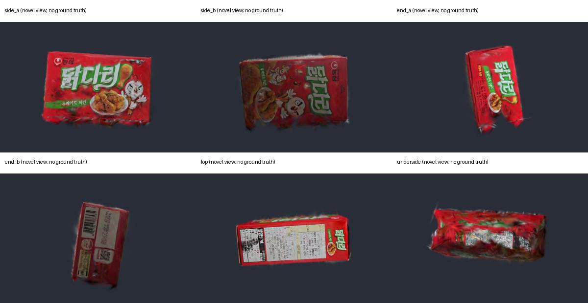

# 닭다리 개봉면 사진 정합 시험

## 결론

**현재 개봉면 사진을 영상 모델에 자동으로 추가하는 방법은 이번 시험에서 채택하지 않았다.** COLMAP은 사진 등록에 성공했다고 출력했지만, 서로 다른 면에 인쇄된 동일 로고를 잘못 연결했다. 기존 50,854개 Gaussian 개발용 에셋을 유지한다. 새 바닥면 에셋을 만들거나 사진을 추가해 재학습한 것은 아니다.

사진 `KakaoTalk_Photo_2026-10-25-01-45-32 001.jpeg`는 개봉선과 ‘뜯는 곳’이 있는 면이다. 영상에서 가려진 반대쪽 면의 후보라는 기존 추정은 유지하지만, 사진에 바닥 후보가 있다는 것과 정확한 3D 위치를 확보했다는 것은 다르다. 사진 자체가 쓸모없다는 판정이나 모든 수동 보완 방법의 불가능 판정은 아니다.

## 실행한 검사

원본 사진·영상과 학습 결과를 보존하고, 기존 COLMAP 데이터베이스를 복사해 시험했다. 별도 사진은 독립 카메라로 등록했다. EXIF 방향을 반영해 PNG로 읽고 사진 대 영상 프레임 전체 쌍을 SIFT로 매칭했다. 원본의 크기나 내용을 변경하지 않았다.

| 입력/조건 | 자동 등록 결과 | 검토 판정 |
|---|---|---|
| V01 74장 + 사진 전체 | 사진 등록, 총 75장 | 자동 등록만으로 채택 불가 |
| V01 74장 + 사진의 상품 영역만 | 사진 등록, 3D 대응점 72개 | 로고가 **성분표 면** 로고에 연결됨. 기각 |
| V02 99장, 기존 등록 93장 + 상품 영역만 | 사진 등록, 총 94장, 3D 대응점 474개 | 로고가 **전면** 로고에 연결됨. 기각 |
| V01 + 반복 로고를 제외한 왼쪽 과자 그림 영역 | 특징점 2,584개, 기하 검증 통과 쌍 0, 사진 미등록 | 올바른 연결 근거 확보 실패 |
| V02 + 같은 과자 그림 영역 | 특징점 2,584개, 기하 검증 통과 쌍 0, 사진 미등록 | 올바른 연결 근거 확보 실패 |

상품 마스크는 붉은 포장의 볼록 외곽선을 추출하고 가장자리를 9px 커널로 침식한 것이다. 대조 시험은 그 마스크에서 사진 너비의 왼쪽 37%만 남겼다. 이 영역은 원본을 보고 반복 로고를 피하도록 수동 선정했다. 이 시험의 실패가 사진 전체에 공통 특징이 전혀 없다는 증명은 아니다.

최다 매칭 쌍은 V01 `frame_0068.jpg`의 167개, V02 `frame_0003.jpg`의 476개였다. 많은 매칭 수가 올바른 면 정합을 보장하지 않는 실제 사례다. 아래 검토 이미지에서 연결선이 반복 로고·문구에 집중되는 것을 확인했다.

- [V01: 개봉면 → 성분표 면 오정합](evidence/dakdari_photo_registration/v01_match_review.jpg)
- [V02: 개봉면 → 전면 오정합](evidence/dakdari_photo_registration/v02_match_review.jpg)
- 기계 판독 기록: [V01](evidence/dakdari_photo_registration/v01_report.json), [V01 과자 그림 대조](evidence/dakdari_photo_registration/v01_unique_report.json), [V02](evidence/dakdari_photo_registration/v02_report.json)

## 기존 에셋 6방향 검토

기존 `Assets/GaussianSplats/DakdariRefined/dakdari.ply`를 변경 없이 gsplat으로 렌더했다. 50,854개, 모든 속성 finite, 입력 PLY SHA-256 불변을 확인했다. 위치 점군의 PCA 축과 0.5–99.5 백분위 범위로 검토 카메라를 배치했다. 이는 실제 치수나 정확한 면 좌표를 계산한 것이 아니다.

앞·뒤·양 측면·성분표 면은 식별할 수 있지만 아래쪽 테두리와 가려진 밑면에 잔상·늘어진 스플랫이 남는다. 밑에서 보는 화면에는 다른 면의 내용이 겹쳐 보인다. 따라서 **선반 배치와 상호작용 개발에는 사용할 수 있으나, 자유롭게 뒤집어 보는 완성품으로 판정하지 않는다.**

이 검토는 새 가상 시점의 시각 검사이며 해당 시점의 실사 정답 이미지가 없다. PSNR, 실제 바코드 판독, HMD 성능 또는 Unity의 이번 재실행 검증을 뜻하지 않는다. [카메라·PLY 검사 기록](evidence/dakdari_photo_registration/six_views/review.json).

## 다음 개발 단계

1. 닭다리 개발용 원본을 유지하고 시뮬레이터에서 배치·집기·회전을 연결한다. 밑면 결함과 미실측 크기는 알려진 제한으로 둔다.
2. 사진을 수동 배치해 보완하려면 상자 평면·크기 비율·180도 방향 등을 가정해야 한다. 이를 실측 복원이라고 부르지 않으며, 이번에는 가정한 면이나 사진 판을 상품에 추가하지 않았다.
3. 고래밥 등 다른 상품의 복원 시험은 닭다리의 밑면 문제와 별개로 진행 가능하다.

## 재현 및 파일 보존

- `scripts/windows/test_dakdari_photo_registration.py <session> <photo> <new-output> --colmap <colmap.exe> [--modes product_mask unique_detail]`
- `scripts/windows/review_product_splat.py <ply> <output>`
- 전체 실험: `capture/products/capture_01/photo_registration_v01`, `photo_registration_unique_v01`, `photo_registration_v02_full`.
- 기존 원본 사진, 입력 DB, 기존 희소 모델 images.bin의 SHA-256 불변을 각 실행에서 확인했다.
- V02 trim 폴더에는 독립 DB가 없어 첫 시도는 매칭 전에 종료됐다. 후속 시험은 원래 V02 DB와 모델을 복사해 수행했다. 실패한 출력 폴더도 원본에 영향을 주지 않는다.
- 기존 Unity 에셋·씬·학습 체크포인트·Windows 실행 파일은 이번 시험에서 수정하지 않았다.
